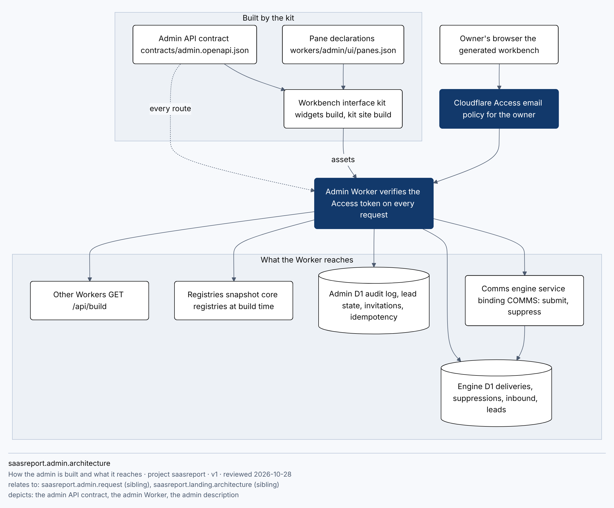
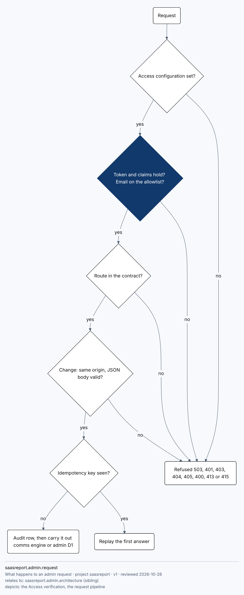

# Admin: admin.saasreport.ai

The owner's console for SaasReport. Contract first: `contracts/admin.openapi.json` (OpenAPI 3.1, one security scheme `cfAccess`) is the source; the Worker in `workers/admin/` implements exactly it, the SDK in `sdk/admin/` is generated from it (`kit sdk generate`), and the interface is generated by the kit's workbench from it. `kit check contracts` holds the contract and the route literals together both ways; `test/admin/contract.test.mjs` proves operation ids, security and permissions.

Diagram source: [admin-architecture.mmd](diagrams/admin-architecture.mmd)

## Access: no password, no user table

There is no password and no credential store anywhere: not in code, configuration, tests or fixtures (`test/admin/hygiene.test.mjs` greps for it). Access is Cloudflare Access in front of the hostname with an email policy for the owner's address only. The Worker also verifies the Access token itself on every request (`workers/admin/src/access.js`):

| Check | Rule |
| --- | --- |
| Configuration | team domain (must be a `*.cloudflareaccess.com` host), AUD tag and email allowlist, read by NAME from Worker secrets (`ACCESS_TEAM_DOMAIN`, `ACCESS_AUD`, `ADMIN_ALLOWED_EMAILS`); anything missing or invalid is a 503 with no detail on every request |
| Keys | RS256 against `https://<team domain>/cdn-cgi/access/certs`, cached 300 s; a key id the cache does not know triggers ONE refetch, not more often than every 10 s; an unusable key set fails closed |
| Claims | `aud` holds the AUD tag, `iss` is the team domain, `exp` and `nbf` with 60 s skew, `email` on the allowlist (403 otherwise, audited as denied by hash) |
| Exception | `GET /api/build` (kit.build.v1: a commit, nothing else) needs no token, because `kit release verify` reads it without a credential |

Every mutation is same-origin (Origin or Sec-Fetch-Site), `application/json`, read through the bounded reader (8 KiB cap, Content-Length required), validated against the contract, written to the append-only audit log and idempotent where the contract says (`Idempotency-Key`). The Worker sets no cookie and no CORS header.

Diagram source: [admin-request.mmd](diagrams/admin-request.mmd)

## The six areas

| Area | Operations | What is real today | What says "not connected" |
| --- | --- | --- | --- |
| User management | `listUsers`, `listRoles`, `listInvitations`, `createInvitation`, `revokeInvitation`, `listAudit` | allowlisted owners (hashes), roles and permissions (RBAC, `x-permission` on every operation), invitations as hashed records, the audit log | acceptance of an invitation: access is the Access policy and the allowlist secret, which the lead changes |
| FinOps | `getFinOps` | nothing | revenue and plans, cloud cost, budgets: no source, so no figure |
| BizOps | `getBizOps`, leads, export | lead funnel, commitments, legal blockers | customers and tenants |
| PlatformOps | `getPlatformOps`, overview, deliveries, retry, inbound, alerts, suppressions | Worker builds, delivery ledger, owner-alert failures, suppressions | monitor status |
| SaaSOps | `getSaaSOps`, registries | report types, stakeholders, metrics, findings rules | tenants and usage, reports generated |
| InfraOps | `getInfraOps`, provisioning | bindings present or missing, planned names against the naming registry | release records, backups and drills |

A section that has no source says so and shows no figure; nothing is estimated or filled in.

## Where the data comes from

* Leads: the kit's `leads` table shape in the engine's D1; status and note live in the admin's own `admin_lead_state`, so the admin never alters another Worker's table.
* Deliveries, suppressions: `comms_form_deliveries`, `comms_suppression` of the engine's D1. A retry re-submits the stored submission under the same reference to the engine's idempotent `POST /v1/comms/submit`; the engine picks templates and recipients. Adding a suppression goes through `POST /v1/comms/suppress`. Removing one deletes the row (a dsar-erasure is permanent).
* Inbound mail: `comms_inbound`. The vendored kit (snapshot 380a07bd93e6) has no inbound handler, so the columns read are the ones the contract names; a missing table answers `available: false`. Unverified until the handler is deployed.
* Registries: `workers/admin/generated/snapshot.json`, written by `scripts/admin-snapshot.mjs` from `vendor/core` (a Worker has no file system). Legal blockers use core's `publishBlockers`; the vendored core has no `legal/*.md`, so each document says `text_checked: false`.

## Interface

`admin.widgets.spec.json` and `workers/admin/ui/panes.json` describe the panes; `scripts/admin-ui.mjs` derives sources, row contracts and command arguments from the OpenAPI contract (a column the contract does not have is a build error); `kit widgets build` and `kit site build` make the pages the Worker serves behind Access. Tokens are the landing's. `test/admin/ui.test.mjs` opens it in Chromium at 390 and 1280 against the Worker in-process with a signed test token.

## Lead's provisioning checklist (the lead provisions; nothing here was applied)

No `provisioning.json` exists in the vendored kit, so this is the checklist.

1. Naming: SaasReport/core `claude/naming-admin` must merge (component `admin`, host sub `admin`); until then `saasreport-admin-production` and `admin.saasreport.ai` are not in the registry (`getProvisioning` says so).
2. Cloudflare Access application for `admin.saasreport.ai`, policy: allow the owner's email only. Note the application's AUD tag and the team domain.
3. Worker secrets on `saasreport-admin-production` (names only; values are never in git): `ACCESS_TEAM_DOMAIN`, `ACCESS_AUD`, `ADMIN_ALLOWED_EMAILS` (the owner's address), optional read-only `GITHUB_READ_TOKEN`.
4. D1 `saasreport-admin-production`: create, put its id in `workers/admin/wrangler.toml`, apply `workers/admin/migrations`. Put the engine D1's id in the `ENGINE_DB` binding.
5. DNS and route: custom domain `admin.saasreport.ai` to the Worker, only behind Access. Bypass for `/api/build` if `kit release verify` must read it.
6. Release wiring: `workers/admin/wrangler.toml` is listed as not deployed in `canon.allow.json` until the repository has `release.json`, `resilience.json` (a monitor that does not watch the admin's own D1) and the production workflow; remove that entry when they exist.
7. Inbound handler: deploy and migrate `comms_inbound`, or tell the admin its real column names.

## Proposed kit changes (gaps found; nothing was worked around by hand-written code)

1. Workbench source kind for a private owner API (badge YOURS/PRIVATE): panes now carry the PUBLIC FEED badge, which is wrong for private data.
2. Workbench operations over HTTP (POST, PATCH, DELETE with same-origin and `Idempotency-Key`), a row-to-detail link and a CSV download: today the interface is read-only, so changes are made through the API or the SDK.
3. `kit check contracts` reads JSON only; the task asked for YAML.
4. A generator for a project Worker's `wrangler.toml` (as `@saasreport/comms` has for its two Workers) and a `kit worker` entry for release and resilience.
5. `@saasreport/comms`: a `suppress()` client next to `submitForm`, so no handler needs a bare engine URL (`canon.allow.json` holds one reviewed exception).
6. A kit provisioning registry and the inbound handler with its table in the vendored kit; `legal/*.md` in the vendored core.
7. Workbench: the "as of" line shows a Solar Hijri date on an English page; widgets spec paths for diagrams are root-relative only, which is why `admin.widgets.spec.json` sits at the root.
