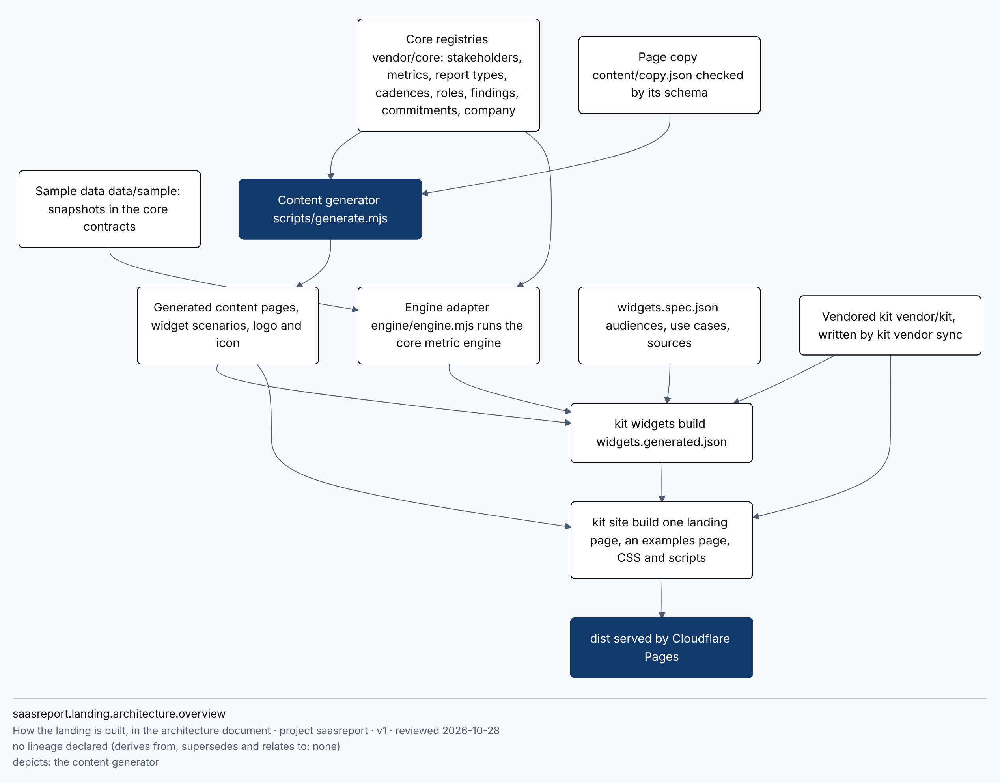
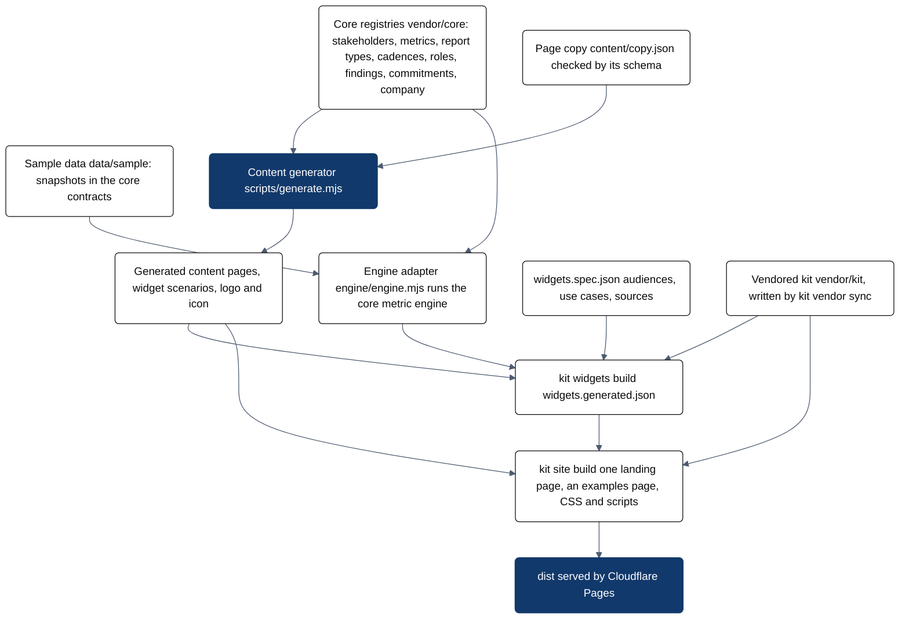
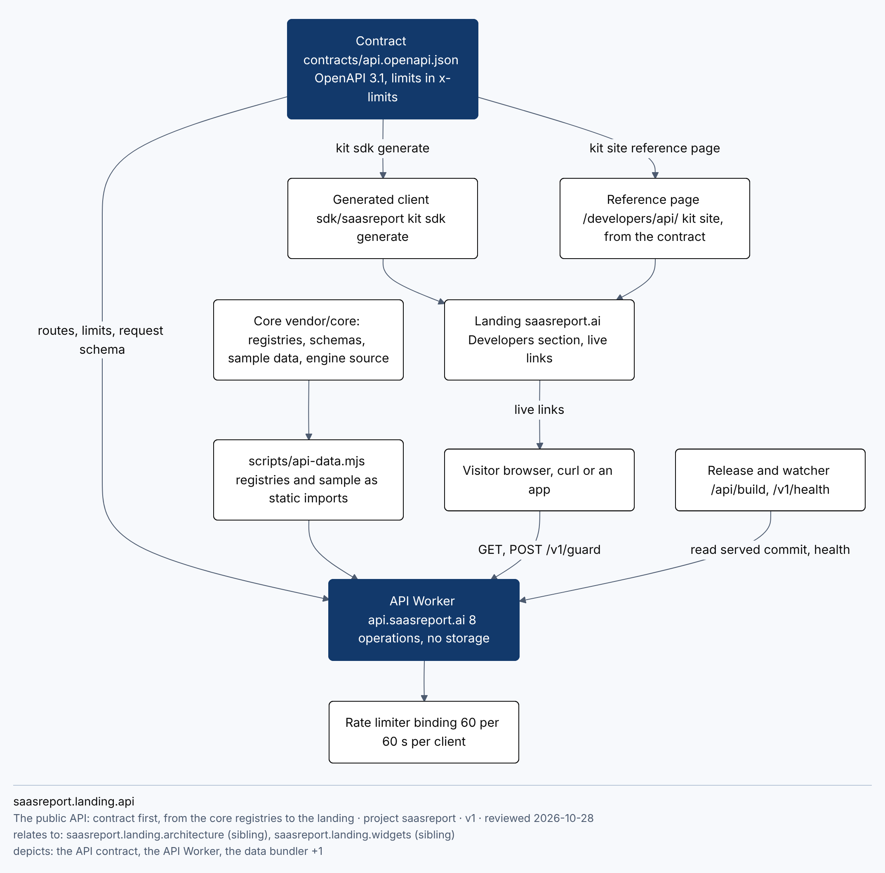
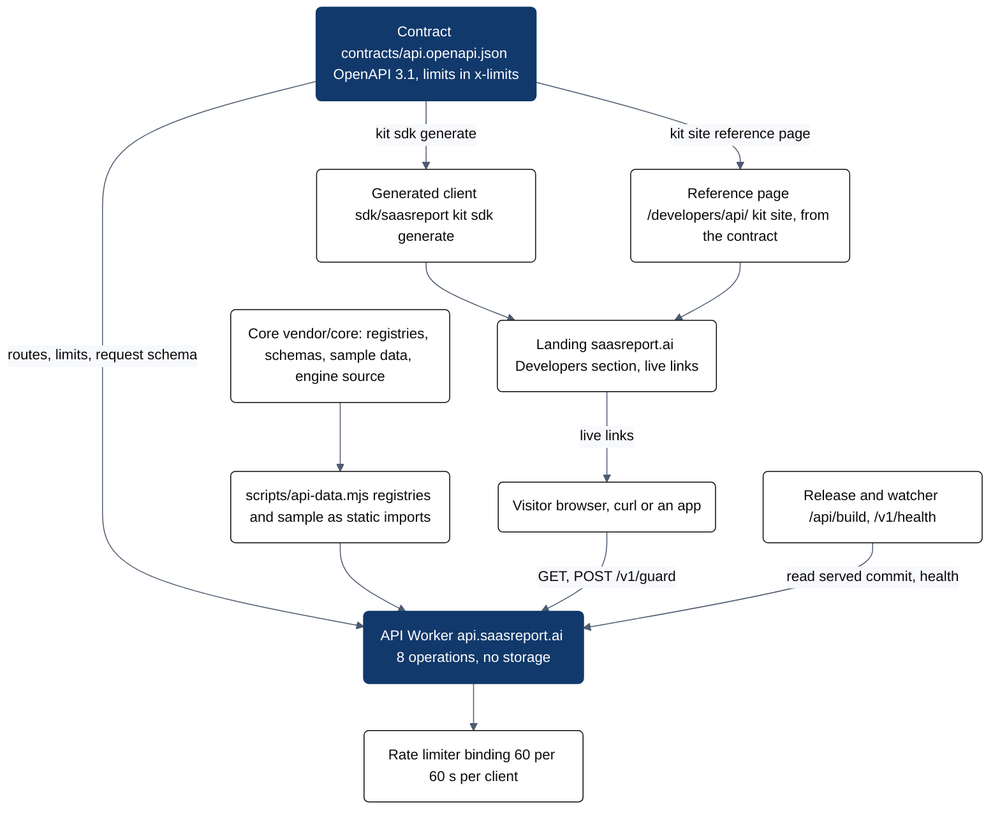

# Architecture of the landing

The landing at saasreport.ai is generated by the SaasReport kit. No page, style or script of it is written by hand.
The registries of SaasReport/core and the page's own copy are the sources; the kit builds `dist`, which Cloudflare Pages
serves (`npm ci && npm run build`, Node 22).

Mermaid source (saasreport.landing.architecture.overview)

The picture of record, with every file, is `docs/diagrams/landing-architecture.png`.

| Piece | What it is | Source of truth |
| --- | --- | --- |
| `vendor/kit` | the SaasReport kit, a snapshot written by `kit vendor sync` | SaasReport/kit |
| `vendor/core` | registries, schemas and the metric engine of SaasReport/core, with hashes in `SOURCE.json` | SaasReport/core |
| `content/copy.json` | the sentences around the facts, checked by `schemas/copy.schema.json` | this repository |
| `vendor/core/sample`, `vendor/core/adapters/widgets-engine.mjs` | the canonical sample dataset and the `$engine` adapter | SaasReport/core |
| `comms.config.js`, `src/forms.js` | the early-access form: comms templates, owner notification, declared fields | content/copy.json, the registries |
| `scripts/generate.mjs` | derives the page, the widget scenarios and the brand files | the registries and the copy |
| `widgets.spec.json` | audiences, use cases and sources of the widgets | this repository |
| `site.config.js`, `tokens.json` | the kit site project and the provisional colour tokens | this repository |

## The public API

api.saasreport.ai is a Cloudflare Worker (`workers/api/`) that implements exactly `contracts/api.openapi.json`. The contract is written first and is the one
source of the Worker's routes, its request schema, its rate limit and body cap (`x-limits`), the typed client (`sdk/saasreport`, `kit sdk generate`) and the
reference page at `/developers/api/` (the kit's `reference` page type). The Worker serves the core registries as they are and runs the core engine on the core
sample dataset; it stores nothing and holds no secret. `docs/API.md` lists the operations, the limits and what is live.

Mermaid source (saasreport.landing.api.overview)

| Piece | What it is | Source of truth |
| --- | --- | --- |
| `contracts/api.openapi.json` | the OpenAPI 3.1 contract; core schemas are referenced by `$id`, never copied | this repository |
| `workers/api/src/worker.js` | the routes, one handler per `operationId`, CORS, caching, limits | the contract |
| `workers/api/src/engine.js` | the core engine on the sample dataset, pure, for a Worker | `vendor/core/src`, `vendor/core/sample` |
| `workers/api/src/data.generated.js` | registries, schemas and sample files as static imports | `scripts/api-data.mjs` |
| `sdk/saasreport` | JavaScript, CLI and Python clients | the contract, `kit.sdk.json` |
| `release.json`, `resilience.json`, `.github/workflows/{production,drift,watch}.yml` | how the Worker is released, proven and watched | the kit's templates |
