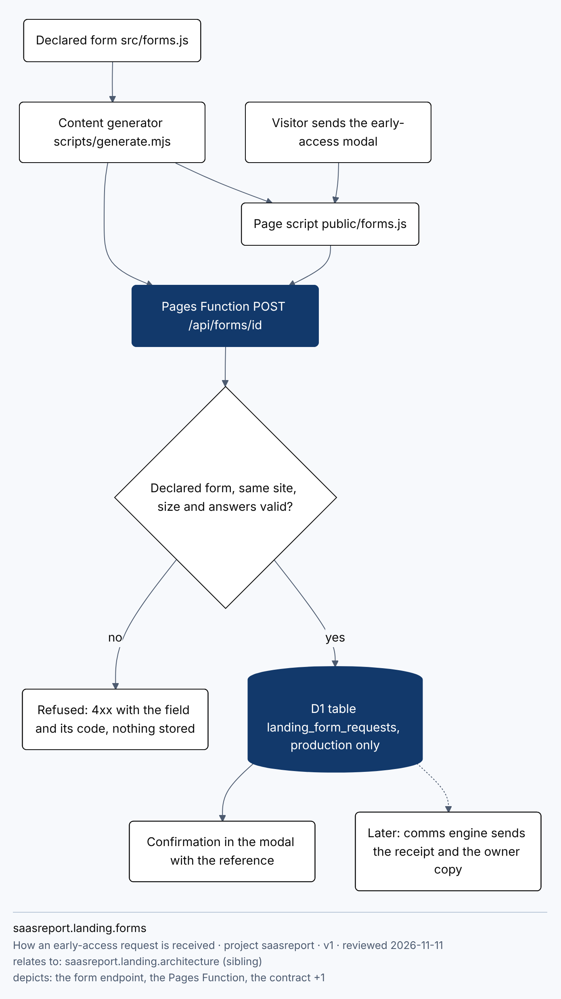
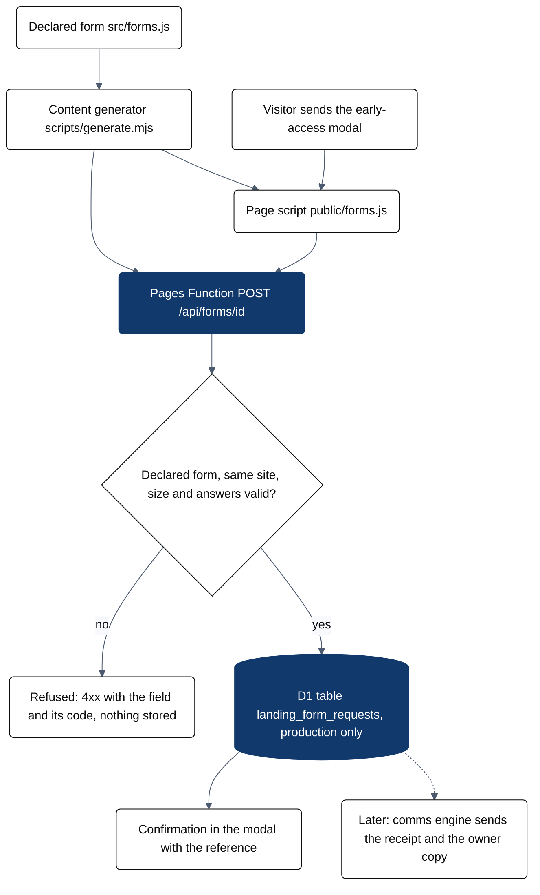

# The landing's forms

The early-access form is declared once in `src/forms.js`. The modal, the endpoint's validation, the contract and the
generated client all come from that declaration through `scripts/generate.mjs`.



<details><summary>Mermaid source (saasreport.landing.forms.doc)</summary>



</details>

## What happens to a request

1. The visitor sends the modal. `public/forms.js` posts the answers as JSON to `POST /api/forms/early-access` and never
   puts them in the address.
2. The Pages Function (`functions/api/forms/[id].js`, logic in `src/form-intake.js`) refuses an undeclared form, a
   request from another site, a body over 16 KiB, a body that is not JSON or a form post, and any answer the declaration
   does not allow. A refusal names the field and its code and stores nothing.
3. A valid request is stored as one row in the D1 table `landing_form_requests` and answered with its reference
   (`SR-<date>-<8 hex>`), which the modal shows.

The contract is `contracts/forms.openapi.json`. `test/forms-endpoint.test.mjs` answers every status it documents and
no other; `test/forms-browser.test.mjs` sends the real modal at 390x844 and 1280x800.

## This is an interim store

No email is sent. The comms engine is not deployed yet, so there is no confirmation email and no owner copy: the page
says "We write back by email", and the owner reads the requests from the database. When the comms engine and the site
Worker are deployed, this endpoint is replaced by the kit's declared-form intake, which keeps the same path and
contract, and the stored rows are moved to it.

## Where requests are stored

| | |
| --- | --- |
| Database | `saasreport-comms-engine-production` (D1), bound as `FORMS_DB` in `wrangler.toml` |
| Table | `landing_form_requests`, created by the endpoint on its first valid request |
| Columns | `id`, `reference`, `form_id`, `created_at`, `email`, `fields` (the answers as JSON), `consent` |
| Production only | a preview deployment has no database: a form sent from a preview answers 503 and stores nothing |

Reading the requests (owner, Cloudflare dashboard, D1 console):

```sql
SELECT reference, created_at, email, fields FROM landing_form_requests ORDER BY created_at DESC;
```

Deleting one person's request on their ask: `DELETE FROM landing_form_requests WHERE email = ?;`

## Limits and what is not covered

- At most 120 stored requests an hour; more are answered 429 and not stored.
- There is no per-visitor rate limit and no spam filter beyond the declaration's rules.
- Nobody is told when a request arrives. Until the comms engine is live the owner has to look.
- The Pages deployment has no monitor: `kit check canon` reports resilience and release as not configured, which is
  true and stays open until the alert routes exist.
