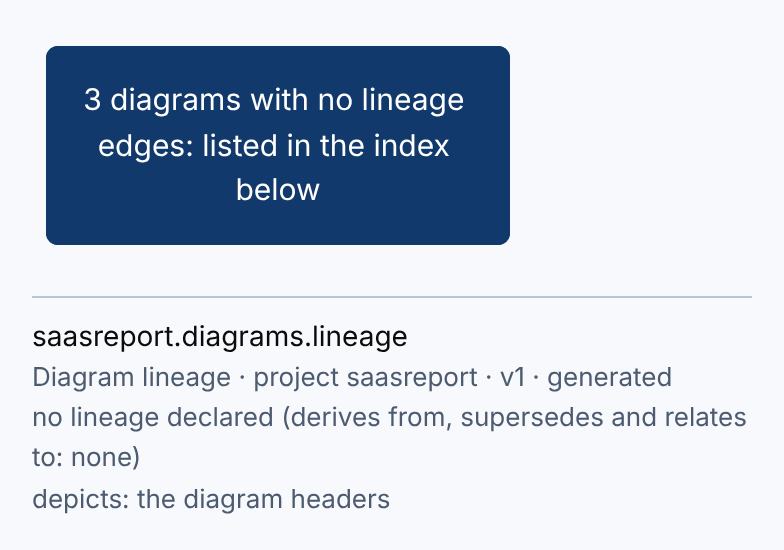
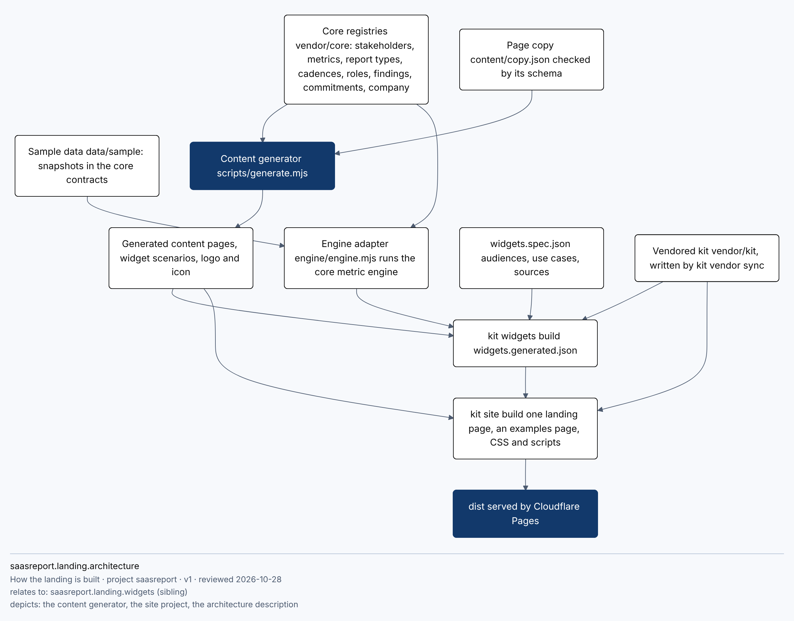
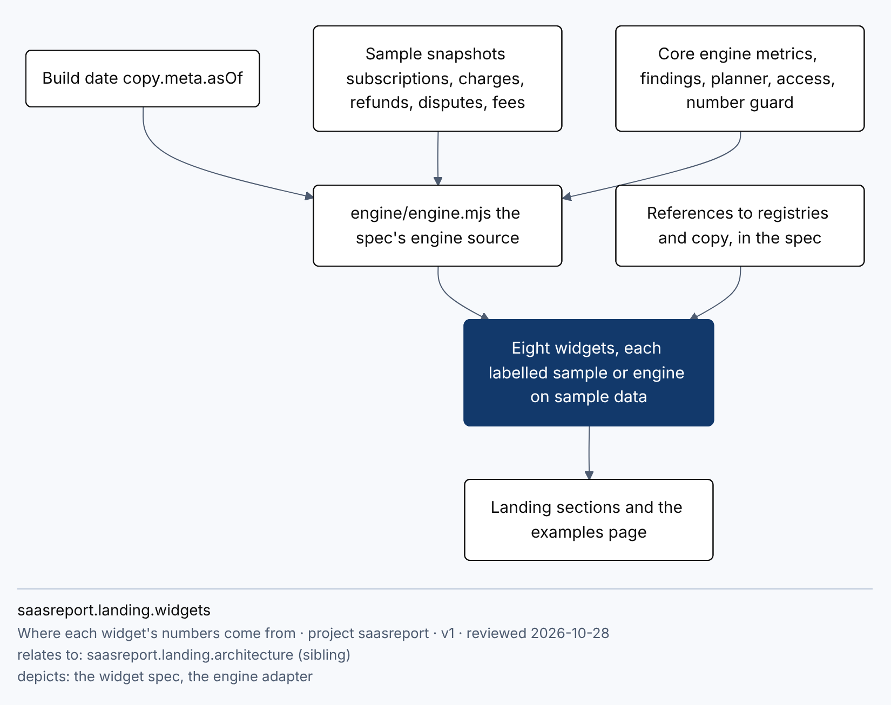

<!-- Generated by `kit diagrams render` from the `%% kit:diagram` headers of the diagram sources. Never edit by hand. -->

# Diagrams: saasreport

Every diagram carries a machine-readable header (id, lineage, relationships, what it depicts: [`kit.diagram.v1`](../DIAGRAMS.md)). This index and the lineage graph are generated from those headers by `kit diagrams render`; `kit diagrams check` fails when a header is missing or wrong, a reference dangles, or this page is stale. Each `.mmd` source is rendered locally (bundled Mermaid + local Chromium, the theme [`theme.init`](theme.init)) to a PNG stamped with its id and source hash, and every image is inspected before it is committed.

## Lineage

Solid arrows: derives from (parent to derived). Dotted: supersedes. Relationships (relates to) are in the index below, not drawn: a graph of every relation is wider than a phone. Dashed boxes: ids declared outside this repository. A diagram that is only a generated copy of another (a Markdown block of a .mmd) is folded into its parent as 'n copies'.

Source: [`lineage.mmd`](lineage.mmd)

## Index (4)

| id | title | kind | derives from | relates to | depicts | source |
| --- | --- | --- | --- | --- | --- | --- |
| `saasreport.diagrams.lineage` v1 | Diagram lineage (generated) | other | none | none | doc: [the diagram headers]() | [lineage.mmd](lineage.mmd) |
| `saasreport.landing.architecture` v1 | How the landing is built | architecture | none | sibling `saasreport.landing.widgets` | file: [the content generator](../../scripts/generate.mjs) file: [the site project](../../site.config.js) doc: [the architecture description](../ARCHITECTURE.md) | [landing-architecture.mmd](landing-architecture.mmd) |
| `saasreport.landing.architecture.overview` v1 | How the landing is built, in the architecture document | architecture | none | none | file: [the content generator](../../scripts/generate.mjs) | [ARCHITECTURE.md #1](../ARCHITECTURE.md) |
| `saasreport.landing.widgets` v1 | Where each widget's numbers come from | flow | none | sibling `saasreport.landing.architecture` | file: [the widget spec](../../widgets.spec.json) file: [the engine adapter](../../engine/engine.mjs) | [landing-widgets.mmd](landing-widgets.mmd) |

## saasreport.diagrams.lineage

Diagram lineage. Every diagram of this repository and how they derive from, supersede and relate to one another; generated from the diagram headers.

Source: [`lineage.mmd`](lineage.mmd)

## saasreport.landing.architecture

How the landing is built. From the core registries and the page's own copy, through the content generator, the kit's widgets and site builders, to dist on Cloudflare Pages.

Source: [`landing-architecture.mmd`](landing-architecture.mmd)

## saasreport.landing.widgets

Where each widget's numbers come from. Every widget text is a reference to a registry or the copy file, or an engine call on the sample data at the build date.

Source: [`landing-widgets.mmd`](landing-widgets.mmd)
