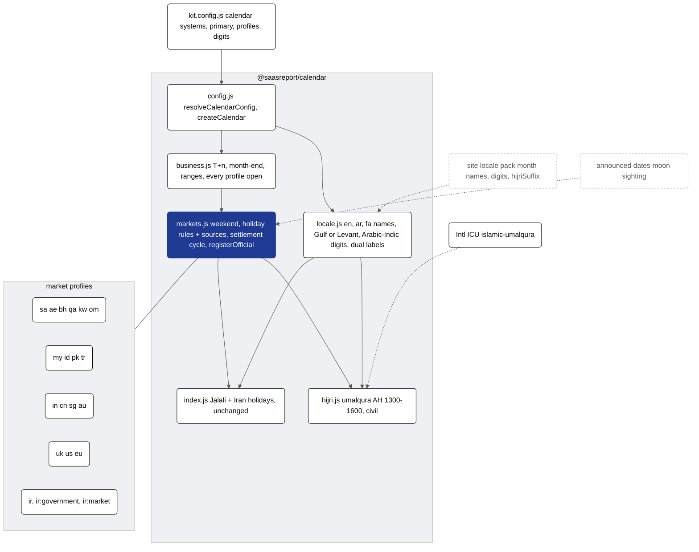
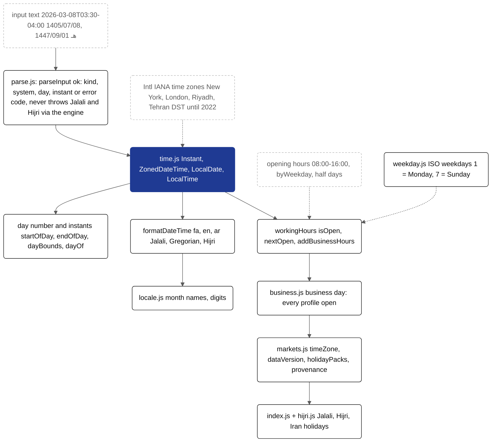
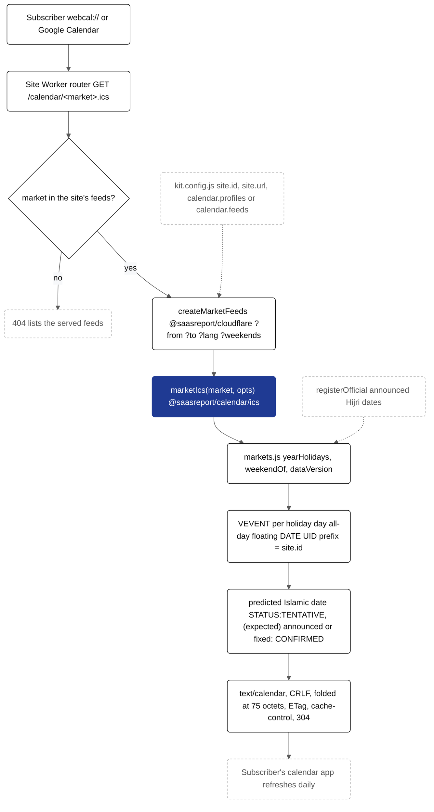
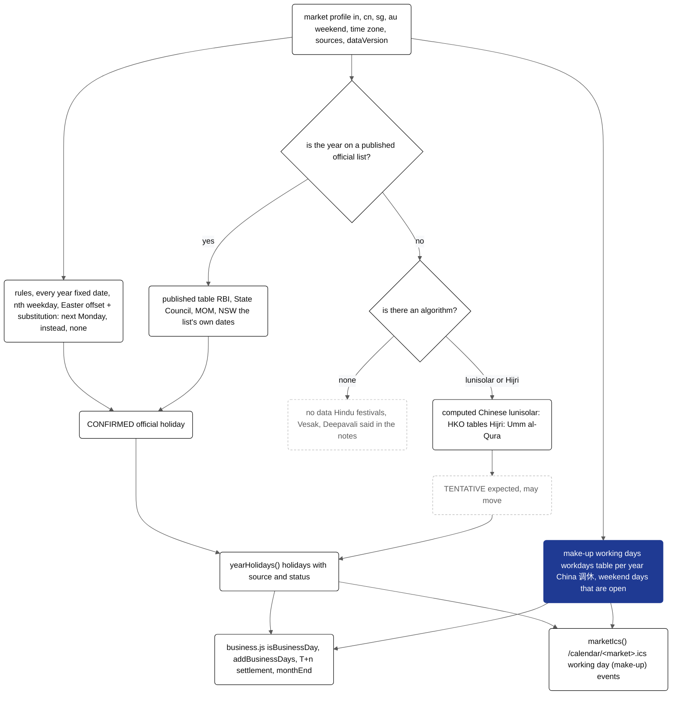

# @saasreport/calendar

Financial calendar engine: Solar Hijri (Jalali), Gregorian and lunar Hijri dates, official Iranian holidays,
business days with weekend profiles, T+n settlement, instalment schedules, deadlines, iCalendar output and a
date-picker web component. One dependency-free ES module; runs in browsers, Workers and Node ≥ 20. License: Apache-2.0.

| Entry | Import |
| --- | --- |
| Engine | `import * as cal from "@saasreport/calendar"` |
| HTTP client (for a site that serves `/api/calendar/*`) | `import { KitCalendarClient } from "@saasreport/calendar/client"` |
| Date picker web component | `import "@saasreport/calendar/picker"` |
| CLI | `kit-cal settle 1404/12/28 --t 1` |

```js
import { parseDate, settlement, schedule, describe, isBusinessDay, ics } from "@saasreport/calendar";
const t1 = settlement(parseDate("1404/12/28"), 1);        // → 1405/01/05, skipping Esfand 29, Nowruz and Friday
schedule({ start: "1405/05/31", count: 12, amount: 1_200_000_000, convention: "modified_following" });
isBusinessDay(parseDate("2026-03-21"), { weekend: [6], holidays: false }); // weekends only, no holiday table
ics({ from: 1405, to: 1405, name: "My calendar", domain: "example.org" });          // Jalali years (legacy form)
ics({ from: "2026-10-01", to: "2026-12-31", timeZone: "Europe/London", uidPrefix: "cal-" }); // a date range
new KitCalendarClient({ baseUrl: "https://example.org" });                // baseUrl is required
```

**Rules**
- Days are integers (days since 1970-01-01, UTC), and `today()` is the civil day in `Asia/Tehran`.
- Solar Hijri holidays are `official`. Lunar holidays are `predicted` (±1 day, depending on moon sighting) until the official table for that year is registered with `registerOfficialLunar()`.
- A result is marked `uncertain: true` only when a predicted holiday falls on a day that would otherwise be a working day.
- Weekend profiles: `bank` means Friday only; `government` and `market` mean Thursday and Friday. `weekend: [...]` overrides
  (legacy Saturday-first weekday numbers: 0 = Saturday … 6 = Friday; see *Weekdays* below). `holidays: false` ignores the holiday table.

## Markets, Hijri and Gregorian (other projects)

The engine above is Iran's. Other projects pick calendar systems and market profiles in `kit.config.js`;
the Iran engine is untouched and is itself one of the profiles (`ir`, `ir:government`, `ir:market`).

```js
// kit.config.js
calendar: {
  systems: ["gregorian", "hijri-umalqura"],      // shown side by side ("hijri" = "hijri-umalqura")
  primary: "gregorian",                          // leads labels and month grids (default: systems[0])
  profiles: ["sa", "ae", "my", "us", "uk", "eu"], // market profiles; the first is the default market
  digits: "arabic",                              // optional: "latin" | "arabic" | "persian" (else the locale pack's)
}
// the legacy shape still works: { system: "jalali", holidays: "iran" } → systems ["jalali"], profiles ["ir"]
```


<details><summary>Mermaid source (kit.packages.calendar.readme.1)</summary>



</details>

| Entry | What it does |
| --- | --- |
| `@saasreport/calendar/config` | `resolveCalendarConfig(calendar, { locale })` (normalises, lists `problems`), `createCalendar(calendar, { locale, pack })` (everything below bound to the config) |
| `@saasreport/calendar/hijri` | `toHijri(n, variant)`, `fromHijri(hy, hm, hd \| "last", variant)`, `hijriMonthLength`, `hasUmmAlQura()` |
| `@saasreport/calendar/markets` | profiles, `yearHolidays(id, gy)`, `holidaysOn`, `holidaysBetween`, `weekendOf`, `settlementCycle`, `registerOfficial`, `registerMarket`, `holidayTitle` |
| `@saasreport/calendar/business` | `isBusinessDay`, `dayStatus`, `addBusinessDays`, `settlement(n, profiles, { t })`, `businessDaysBetween`, `businessDays`, `monthEnd`, `adjust` over one or several profiles |
| `@saasreport/calendar/locale` | `monthNames`, `weekdayNames`, `formatDate`, `formatDual`, `monthTitle`, `monthSpan`, `toDigits` |

```js
import { createCalendar } from "@saasreport/calendar/config";
import { fromISO } from "@saasreport/calendar";
const cal = createCalendar({ systems: ["gregorian", "hijri-umalqura"], profiles: ["sa", "us"] }, { locale: "ar" });
cal.label(fromISO("2026-02-18")).text;                    // "١٨ فبراير ٢٠٢٦ (١ رمضان ١٤٤٧ هـ)"
cal.settlement(fromISO("2026-09-21"), { t: 2 }).iso;      // "2026-09-24": SAR/USD, skipping Saudi National Day (23rd)
cal.monthEnd(fromISO("2026-10-10")).iso;                  // "2026-10-29": 30 Oct is Friday, 31 Saturday in Riyadh

import { formatDate, monthNames } from "@saasreport/calendar/locale";
formatDate(fromISO("2026-02-18"), { system: "hijri-umalqura" });              // "1 Ramadan 1447 AH"
formatDate(fromISO("2026-02-18"), { system: "hijri-umalqura", locale: "ar" }); // "١ رمضان ١٤٤٧ هـ"
monthNames("gregorian", "ar", { variant: "levant" });                          // ["كانون الثاني", "شباط", …]
formatDate(n, { system: "hijri", pack });   // a site locale pack's month names, digits and hijriSuffix win
```

**Calendars.** `hijri-umalqura` is the official Umm al-Qura calendar of Saudi Arabia (KACST, AH 1300–1600), read from
ICU's `islamic-umalqura` through `Intl.DateTimeFormat`; ICU carries the Umm al-Qura month table for exactly that span, so
dates outside it throw `out_of_range`, and a runtime without that ICU calendar throws `unsupported_calendar` (Node,
browsers and Workers ship it). `hijri-civil` is the tabular Islamic calendar, pure arithmetic, equal to ICU `islamic-civil`.
`gregorian` and `jalali` complete the set. Names: `en` and `ar` for Gregorian (Arabic `gulf` يناير… by default, or
`levant` كانون الثاني…) and Hijri (Muharram … Dhu al-Hijjah, `AH`; محرم … ذو الحجة, `هـ`), weekdays in both, and Arabic-Indic
digits for `ar` unless `digits: "latin"`. Weekdays in these modules count from Sunday (0 = Sunday), like kit.config.js
(legacy; see *Weekdays* below).

**Profiles** (sources read on 2026-09-30; each rule carries its `source` URL):

| Id | Market | Weekend | Holidays from | Status |
| --- | --- | --- | --- | --- |
| `sa` | Saudi Arabia | Fri–Sat | Saudipedia (Founding Day, National Day); Eid days predicted, the yearly Eid break is not modelled | partial |
| `ae` | UAE | Sat–Sun from 2022-01-01, Fri–Sat before | [u.ae public holidays](https://u.ae/en/information-and-services/public-holidays-and-religious-affairs/public-holidays) (Cabinet Resolution 27/2024), Abu Dhabi Media Office for the weekend | verified |
| `bh` | Bahrain | Fri–Sat | [CBB official bank holidays](https://www.cbb.gov.bh/official-bank-holidays/) | verified |
| `qa` | Qatar | Fri–Sat | no official list readable: the two Eids, predicted | unverified |
| `kw` | Kuwait | Fri–Sat | no official list readable: Eids, Islamic New Year, Mawlid, predicted | unverified |
| `om` | Oman | Fri–Sat | Royal Decrees 88/2022 and 15/2025 (English text on Decree.om) | verified |
| `my` | Malaysia (Kuala Lumpur) | Sat–Sun | [BNM head-office holidays](https://www.bnm.gov.my/upcoming-events); lunisolar holidays (Thaipusam, Chinese New Year, Wesak, Deepavali) left out | partial |
| `id` | Indonesia | Sat–Sun | no official list readable: Eids, Islamic New Year, Mawlid, predicted | unverified |
| `pk` | Pakistan | Sat–Sun | [PSX calendar holidays](https://www.psx.com.pk/psx/exchange/general/calendar-holidays) | verified |
| `tr` | Türkiye | Sat–Sun | [Law 2429](https://www.mevzuat.gov.tr/mevzuat?MevzuatNo=2429&MevzuatTur=1&MevzuatTertip=5); eves are `half: true` business days | verified |
| `uk` | UK (England and Wales) | Sat–Sun | [GOV.UK bank holidays](https://www.gov.uk/bank-holidays.json), substitute days; T+2, T+1 from 2027-10-11 | verified |
| `us` | US (Federal Reserve) | Sat–Sun | [Fed K.8](https://www.federalreserve.gov/aboutthefed/k8.htm), Sunday → Monday; T+1 from 2024-05-28 (SEC) | verified |
| `eu` | Euro area (T2) | Sat–Sun | [ECB T2 closing days](https://www.ecb.europa.eu/paym/target/t2/html/index.en.html); T+2, T+1 from 2027-10-11 (ESMA) | verified |
| `ir`, `ir:government`, `ir:market` | Iran | Fri / Thu–Fri | the engine above, unchanged | verified |

**Rules**
- Every holiday computed from the Hijri calendar is `predicted: true` with `note` (en, ar): the date is confirmed by moon
  sighting or official announcement and may move by a day. `registerOfficial("pk", { 1447: { "eid-al-fitr": ["2026-03-21", …] } })`
  replaces a prediction with the announced days.
- With several profiles a day is a business day only when every market is open; `dayStatus` says which market is closed and why.
- `uncertain: true` when a predicted holiday on an otherwise open day decides the result.
- `settlement(n, profiles)` without `t` uses the longest official cycle of the profiles on that date, and throws `no_cycle`
  when a profile has none on record (only `us`, `uk` and `eu` do); pass `{ t }` otherwise.
- Unverified profiles hold only the weekend and predicted Islamic holidays: nothing is invented.

## Time layer, input parser, weekdays and holiday packs (1.2)

All additive: every earlier export returns exactly what it did (`test/iran-snapshot.test.mjs` still matches).

| Entry | What it does |
| --- | --- |
| `@saasreport/calendar/time` | `Instant`, `ZonedDateTime`, `LocalDate`, `LocalTime`, `startOfDay` / `endOfDay` / `dayBounds` / `dayOf` (engine day number ↔ zoned instants), `formatDateTime`, `workingHours`, `offsetMinutes`, `wallToEpoch`, `isValidTimeZone` |
| `@saasreport/calendar/parse` | `parseInput(text, { timeZone, now, hijri, disambiguation })` → `{ ok: true, kind, system, day, iso, parts, weekday, instant?, zoned? }` or `{ ok: false, error: { code, message } }`; never throws |
| `@saasreport/calendar/relative` | `resolveRelative(text, { now, timeZone, profile })`: Persian relative expressions on top of `parseInput` («سه روز کاری بعد از ۱۵ مهر ساعت ۱۰», «فردا», «۵ روز قبل»); number words, an optional time, a missing year assumed and reported; refuses instead of guessing |
| `@saasreport/calendar/weekday` | ISO weekdays (1 = Monday … 7 = Sunday), `isoWeekday(n)`, `convertWeekday(v, from, to)`, `fromSaturdayIndex`, `fromSundayIndex`, `toSaturdayIndex`, `toSundayIndex`, `parseWeekday` |
| `@saasreport/calendar/markets` (new) | `timeZone` and `dataVersion` on every profile, `MARKET_TIME_ZONES`, `marketTimeZone`, `isoDow`, `weekendIsoOf`, `holidayPacks()`, `holidayPack(id)`, `holidayProvenance(h)` |
| `@saasreport/calendar` (new) | `isoWeekday(n)` next to the legacy `weekday(n)` |

```js
import { Instant, ZonedDateTime, dayBounds, formatDateTime, workingHours } from "@saasreport/calendar/time";
import { parseInput } from "@saasreport/calendar/parse";
import { fromISO } from "@saasreport/calendar";

ZonedDateTime.from({ timeZone: "America/New_York", year: 2026, month: 3, day: 8, hour: 2, minute: 30 }).toString();
// "2026-03-08T03:30:00-04:00[America/New_York]" — 02:30 does not exist; "compatible" moves forward (also earlier, later, reject)
dayBounds(fromISO("2021-03-22"), "Asia/Tehran");     // starts 01:00 +04:30, 23 hours (Iran's DST, last used in 2022)
formatDateTime(Instant.from("2026-09-30T05:00:00Z"), { timeZone: "Asia/Tehran", locale: "fa" }); // "۸ مهر ۱۴۰۵، ۰۸:۳۰"

const us = workingHours({ profiles: "us", hours: "09:00-17:00" });   // zone from the profile: America/New_York
us.nextOpen("2026-11-26T15:00:00Z");                  // Thanksgiving → Fri 27 Nov 09:00 EST
us.addBusinessHours("2026-10-02T20:00:00Z", 2);       // Fri 16:00 + 2h → Mon 10:00
workingHours({ profiles: "ir", hours: "08:00-16:00", byWeekday: { thursday: "08:00-12:00" } });

parseInput("۱۴۰۵/۰۷/۰۸");          // { ok: true, kind: "date", system: "jalali", iso: "2026-09-30", weekday: 3, … }
parseInput("1447/09/01 هـ");        // { ok: true, system: "hijri-umalqura", iso: "2026-02-18", … }
parseInput("2026-03-08T03:30-04:00"); // { ok: true, kind: "datetime", instant, zoned, offsetMinutes: -240, … }
parseInput("1404/12/30");           // { ok: false, error: { code: "invalid_date", message: "… (1404 is not a leap year)." } }
```


<details><summary>Mermaid source (kit.packages.calendar.readme.2)</summary>



</details>

**Weekdays.** The canonical convention is ISO 8601, 1 = Monday … 7 = Sunday, and every new API uses it (`byWeekday`
keys, `parseInput().weekday`, `ZonedDateTime.isoWeekday`, `weekendIsoOf`). Two legacy conventions stay as they were:
`saturday0` (index.js `weekday()`, `PROFILES[*].weekend`, `opts.weekend`, the picker) and `sunday0` (markets.js `dow()`
and profile `weekend`, business.js, locale.js `weekdayNames`, kit.config.js). Convert at the boundary with
`convertWeekday(v, "saturday0", "iso")` and friends.

**Time zones.** Only `Intl` (the runtime's IANA tz data): no dependency, no bundled tables. Each profile has a default
`timeZone` (Asia/Riyadh, Asia/Dubai, Europe/London, America/New_York, Asia/Tehran, …). The euro area's old
`timezone: "Europe/Frankfurt"` is not an IANA zone and is kept unchanged for compatibility; its `timeZone` is
`Europe/Berlin`. Wall times in a DST gap or fold follow Temporal's `disambiguation`.

**Working hours.** A day has sessions only when it is a business day for every profile on its local date (weekends,
holidays, multi-market). `hours` may be one range, a list (split sessions) or `{ open, close }`; `byWeekday` overrides
per ISO weekday (or name), `null` closes; `halfDayClose` (default `"13:00"`) shortens half days such as Türkiye's eves.
Sessions are `[open, close)`; overnight sessions are not supported. `addBusinessHours` accepts fractions and negative
hours; landing exactly on a close returns the close.

**Holiday packs.** Every profile carries `dataVersion` (`"<pack>-<yyyy.mm.dd>"`: `uk-2026.09.30`, `iran-2026.10.01`).
`holidayPacks()` returns, per profile and in a fixed order: `dataVersion`, `status`, `checked` (the day the sources
were read), `sources` and `sourceUrls`, `coverage` (`from`/`to` Gregorian years and the basis), announced years, and
each holiday rule with its `source` and `checked` (null where nothing was read; nothing is claimed). The Iran pack is
shared by `ir`, `ir:government` and `ir:market`; its official sources could not be read from this environment, so its
holidays have `checked: null`. `holidayProvenance(h)` answers the same for one holiday from `yearHolidays`.

## Calendar arithmetic, rolls, ICS ranges and name parsing (1.2.x)

Additive; the Iran snapshot only gains hashes for the new `nearest` convention (and the corrected `VERSION`).

| Where | What |
| --- | --- |
| `ZonedDateTime.plus/minus` | `years` and `months` (applied first, then weeks/days, then exact time) in `{ calendar }`: `"gregorian"` (default), `"jalali"`, `"hijri"` / `"hijri-umalqura"`, `"hijri-civil"`; the day of the month is clamped to the target month's end. Unknown units, non-finite values and fractional months/years throw `TimeError` `"invalid_duration"` (never ignored); `Instant.plus` takes exact units only. |
| `addMonths(day, months, calendar)` (`/time`) | The same month arithmetic on engine day numbers. |
| `String(z)`, `` `${z}` ``, `"" + z` | ISO text (`2026-10-01T10:30:00+03:30[Asia/Tehran]`; `Instant`: `…Z`) via `Symbol.toPrimitive`; `+z`, `a - b`, `a < b` still use epoch ms. |
| `adjust(n, "nearest", …)` | Rolls to the closer of the next and previous business day; a tie goes forward. In both `@saasreport/calendar` and `/business`. |
| `ics({ from, to, … })` | `from`/`to`: Jalali years (integers below 3000, as before) or inclusive dates (ISO, Jalali text, day numbers; `unit: "year" \| "day"` forces the reading). No range: the current Jalali year. Options `timeZone` (X-WR-TIMEZONE, default Asia/Tehran), `name`, `uidPrefix`, `domain`, `prodid`. The default `uidPrefix` is `"cal-"`; a project passes its own. |
| `parseInput` (`/parse`) | Dates with month names in en, fa and ar: `"۹ مهر ۱۴۰۵"`, `"پنجشنبه ۹ مهر ۱۴۰۵"`, `"٢٠ ربيع الآخر ١٤٤٨ هـ"`, `"1 October 2026"`, `"October 1, 2026"`; a leading weekday must match the date. `parseMonthName(name)` → `{ system, month }`. |
| `normalizeText` (`/parse`, `/weekday`) | Persian and Arabic-Indic digits → Latin, `ي`/`ى` → `ی`, `ك` → `ک`, bidi marks/ZWJ/tatweel removed, ZWNJ normalised. `parseWeekday` and month names match across these forms (`"يكشنبه"`, `"سه شنبه"`, `"الإثنين"`). |
| `resolveCalendarConfig` | Idempotent: an already-normalised block (`defineConfig(...).calendar`, market ids in `markets`) resolves to the same profiles. |

```js
import { ZonedDateTime, addMonths } from "@saasreport/calendar/time";
const z = ZonedDateTime.from("2026-09-22T08:00:00+03:30[Asia/Tehran]"); // 31 Shahrivar 1405
`${z.plus({ months: 1 }, { calendar: "jalali" })}`;  // "2026-10-22T08:00:00+03:30[Asia/Tehran]" — 30 Mehr (clamped)
z.plus({ month: 1 });                                // throws TimeError invalid_duration (typo, not ignored)
```

## Market holiday feeds (`/ics`, 1.3.0)

`marketIcs(market, options)` turns any profile's holidays into a subscribable RFC 5545 feed. `ics()` above stays the
Iranian (Jalali) feed, unchanged apart from the version in its PRODID.

```js
import { marketIcs } from "@saasreport/calendar/ics";
marketIcs("sa", { uidPrefix: "example-", domain: "example.org" });               // this year and next
marketIcs("ae", { from: 2027, to: 2028, locale: "ar", weekends: true, url: "https://example.org/calendar/ae.ics" });
marketIcs("uk", { from: "2027-12-01", to: "2027-12-31", name: "UK bank holidays", refresh: "PT12H" });
```

| Option | Default | |
| --- | --- | --- |
| `from`, `to` | this Gregorian year and the next (in the market's zone at `now`) | Gregorian years or ISO dates, inclusive; at most 10 years, 1900–2100 |
| `uidPrefix` | `"cal-"` | the site's own prefix (the Cloudflare runtime passes `<site.id>-`) |
| `domain` | `"calendar.invalid"` | right of the UID `@` |
| `name`, `description` | `"<market name> holidays"` | `NAME` / `X-WR-CALNAME`, `X-WR-CALDESC` |
| `locale` | `"en"` | `"ar"`, `"fa"`: titles, the "(expected)" label, notes |
| `weekends` | `false` | weekly all-day weekend events, one `RRULE:FREQ=WEEKLY;BYDAY=…;UNTIL=…` per weekend definition |
| `url` | — | `URL` and `SOURCE` |
| `refresh` | `"P1D"` | `REFRESH-INTERVAL;VALUE=DURATION` and `X-PUBLISHED-TTL` |
| `stamp`, `prodid`, `now` | | `DTSTAMP` defaults to the profile's data version date, so the body only changes when the data does |

- One all-day `VEVENT` per holiday day, floating `DTSTART;VALUE=DATE` / `DTEND` (no `VTIMEZONE` needed; `X-WR-TIMEZONE` names the market zone).
- Predicted Islamic holidays: `STATUS:TENTATIVE`, `SUMMARY:Eid al-Fitr (expected)`, `CATEGORIES:HOLIDAY,EXPECTED`, `PREDICTED_NOTE` in `DESCRIPTION`.
  Announced (`registerOfficial`) and fixed dates: `STATUS:CONFIRMED`; announced ones get `SEQUENCE:1`. Half days and substitute days are labelled.
- Stable UIDs: Hijri holidays `<prefix><market>-h<hijriYear>-<rule>-<k>@<domain>` (the same event when an announcement moves the date),
  others `<prefix><market>-<yyyymmdd>-<rule>@<domain>`.
- CRLF line endings, TEXT escaping (`escapeText`), lines folded at 75 octets without splitting a UTF-8 character (`foldLine`).
- Errors are `MarketError`: `unknown_market`, `invalid_range`, `invalid_option`. `hasMarketFeed(id)` checks an id.


<details><summary>Mermaid source (kit.packages.calendar.readme.3)</summary>



</details>

## Asia-Pacific markets, published lists and make-up working days (1.4.0)

Four profiles: `in` India (Mumbai, RBI NI Act bank holidays), `cn` China (mainland), `sg` Singapore and `au` Australia
(New South Wales). Saturday–Sunday weekends; time zones Asia/Kolkata, Asia/Shanghai, Asia/Singapore, Australia/Sydney;
data version `<id>-2026.10.01`.

| Profile | Official source (read 2026-10-01) | Published years |
| --- | --- | --- |
| `in` | RBI holiday matrix, Mumbai regional office, NI Act: https://www.rbi.org.in/Scripts/HolidayMatrixDisplay.aspx | 2025, 2026 |
| `cn` | State Council Decree 795 (rules from 2025): https://www.gov.cn/zhengce/content/202411/content_6986380.htm; notices for 2025 (content_6986382) and 2026 (content_7047091) | 2025, 2026 |
| `sg` | Ministry of Manpower: https://www.mom.gov.sg/employment-practices/public-holidays | 2025–2027 |
| `au` | NSW Government: https://www.nsw.gov.au/about-nsw/public-holidays, plus the 2021–2023 and 2024–2026 NSW lists | rules (lists checked 2021–2027) |

- **Published tables.** `published: { 2026: url }` names the years whose list was read; a rule's `table: { 2026: [...] }`
  holds that list's dates. In a published year the table is the data (nothing when the year has no entry); outside it
  the rule computes. `rules.table(id, tab)` is a holiday with no algorithm: published years only.
- **Computed, expected.** `rules.chinese(id, lm, ld, { offset, days })` and `rules.qingming(id)` use `chinese.js`
  (`@saasreport/calendar/chinese`: `fromLunar`, `toLunar`, `lunarNewYear`, `qingming`), a table derived from the Hong
  Kong Observatory's conversion tables for lunar years 1901–2099 (checked against all 72,673 days). Like Hijri dates
  they are `predicted: true` (STATUS:TENTATIVE in feeds) until a published list replaces them.
- **No data.** Hindu, Jain, Sikh and Parsi festivals in India and Vesak and Deepavali in Singapore appear only in the
  published years; each profile's `notes` and `holidayPack().coverage.basis` say so.
- **Substitution per rule.** `observe: false` (never), `"instead"` (a weekend date moves to the next weekday: Australia
  Day) or a profile policy, optionally from `observeSince` (NSW Anzac Day additional day from 2026).
- **Make-up working days.** `workdays: { 2026: [["2026-02-14", "spring-festival"]] }` lists weekend days that are
  working days (China's 调休). `isMakeUpWorkday`, `makeUpWorkdays`, `makeUpWorkdaysBetween`; `business.js` counts them as
  open (`marketStatus(…).makeUp`), and `marketIcs` shows them as "Working day (make-up for …)" events
  (CATEGORIES:WORKDAY) and as EXDATEs of the weekly weekend event.


<details><summary>Mermaid source (kit.packages.calendar.readme.4)</summary>



</details>

## Solar Hijri instants without ICU (`@saasreport/calendar/instant`, `/guard`)

ICU's Persian calendar is not a source for dates. The Workers runtime put Nowruz 1405 a day early, so 2026-10-03
rendered as ۱۲ مهر instead of ۱۱ مهر ۱۴۰۵, and older Safari and WebViews can be a day off as well. Every Jalali date
in the kit comes from this package's arithmetic. Intl only supplies the wall-clock day in a time zone (Gregorian
parts), the layout, the weekday, the clock time and the digits.

`instant.js` has no imports. `index.js` re-exports its arithmetic, the Worker asset set ships it next to
`calendar.js`, and `@saasreport/format`'s classic browser bundle inlines it. So Workers, Node and browsers
(`KitFormat.formatInstant`) run the same code.

```js
import { jalaliFor, formatJalali, formatInstant, dateTag } from "@saasreport/calendar/instant";
jalaliFor("2026-10-02T21:00:00Z", "Asia/Tehran");            // { jy: 1405, jm: 7, jd: 11, n } (00:30 on 3 Oct in Tehran)
formatJalali("2026-10-03T08:00:00Z", { locale: "en-US", timeZone: "Asia/Tehran", dateStyle: "long" }); // "Mehr 11, 1405"
formatInstant(at, { locale: "fa-IR", calendar: "jalali", timeZone: "Asia/Tehran", dateStyle: "long" }); // "11 مهر 1405" (digits() → ۱۱ مهر ۱۴۰۵)
formatInstant(at, { locale: "ar-SA-u-ca-islamic-umalqura", dateStyle: "long" });                      // Hijri stays Hijri
dateTag("fa-IR", "jalali");                                 // "fa-IR-u-ca-gregory": Intl lays out, never resolves Persian
```

`formatJalali` takes Intl's options, including `dateStyle` and `timeStyle`, and drops the Gregorian era together with
its space. `dateTag(locale, system)` gives Jalali sites the Gregorian calendar for layout. Every other system keeps the
locale's own calendar, unless that calendar is Persian: an explicit `-u-ca-persian`, or CLDR's default for `fa`, `ps`,
`IR` and `AF`.

Guards (`@saasreport/calendar/guard`):

- `installIntlGuard()` wraps `Intl.DateTimeFormat`, `Intl.Locale` and `Date#toLocale*String`. Anything that resolves
  to the Persian calendar is recorded and refused, whether the tag was concatenated, a variable, a shorthand
  `{ calendar }`, upper case or escaped. The kit's `npm test` loads it for every test file
  (`node --import ./packages/calendar/test/intl-guard.setup.mjs`). A refusal swallowed by a `try/catch` still fails
  the file.
- `icuPersianUses(source, { html })` is the static tripwire for code no test runs. `test/no-icu-persian.test.mjs`
  applies it to every package's `src/` and `assets/`, `examples/` and `templates/` (`.js`, `.mjs`, `.cjs`, `.ts`,
  `.html`), together with the 11 Mehr, Tehran-midnight and Nowruz cases.

`zonedDay` reads Gregorian parts with Intl rather than `time.js`'s `dayOf`, so Workers that only need a date do not
bundle the market tables.

## Date picker

`<kit-date-picker>` is a dependency-free web component on the same engine (`src/picker.js`, types in `src/picker.d.ts`). The class itself is `DatePicker` in `src/picker-core.js` (`@saasreport/calendar/picker-core`), which registers nothing: a project with its own element name subclasses it with `static tag` and `static prefix` (the class prefix of everything it renders) and calls `definePicker(MyPicker)`; set the same values in the site tokens (`picker: { tag, prefix }`) so the theme's `datepicker.css` matches. Jalali month grid, Saturday first, Persian digits, RTL; keyboard (arrows — ArrowLeft is the *next* day, PageUp/PageDown months, Shift+Page years, Home/End, Enter/Space, Escape) and ARIA grid semantics. Weekends follow the business profile, official holidays get a solid orange node, predicted lunar holidays a dashed hollow node with «پیش‌بینی؛ ممکن است یک روز جابه‌جا شود».

Sites can serve a copy as `/datepicker.js` (importing the engine from a static path) with a stylesheet that sets the colour tokens. A copy must also serve `hijri.js` next to it (the picker imports `./hijri.js`); `writeAssets` does both.

```html
<link rel="stylesheet" href="/datepicker.css">
<script type="module" src="/datepicker.js"></script>

<!-- popup around a text input: typing 1405/07/08 or ۱۴۰۵/۰۷/۰۸ syncs the grid -->
<kit-date-picker profile="bank" settlement="1" min="1405/01/01" max="2027-03-20">
  <input name="trade_date" placeholder="۱۴۰۵/۰۷/۰۸" inputmode="numeric">
</kit-date-picker>

<!-- or point at an input elsewhere; range mode; only business days selectable -->
<input id="period"><kit-date-picker for="period" range business-only profile="government"></kit-date-picker>

<!-- inline (no input) -->
<kit-date-picker value="2026-09-30" theme="auto"></kit-date-picker>

<script type="module">
  document.querySelector("kit-date-picker").addEventListener("change", (e) => {
    if (!e.detail) return;               // the input's own native change also bubbles here
    const { jalali, iso, business, holidays, settlement } = e.detail;
    // "1405/12/28", "2027-03-19", false, [], { t: 1, iso: "2027-03-25", long: "پنجشنبه ۵ فروردین ۱۴۰۶", uncertain: false }
  });
</script>
```

| Attribute | Meaning |
| --- | --- |
| `profile` | `bank` (Friday weekend, default), `government`, `market` (Thursday + Friday) |
| `business-only` | non-business days (weekend, official or predicted holiday) are disabled |
| `settlement="n"` | footer shows «تسویه T+n: …» for the focused or hovered day, and `detail.settlement` |
| `range` | pick start and end; `value` becomes an ISO interval `2026-09-30/2026-10-04` |
| `min`, `max` | ISO or Jalali, any digits |
| `value` | initial value, ISO or Jalali |
| `for` | id of the input to attach to (otherwise the first `<input>` child; without one the grid is inline) |
| `theme` | `light`, `dark` or `auto` (follows the OS); by default it follows the page's tokens |
| `digits` | `fa` (default) or `latin` for the text written into the input |
| `hijri` | lunar date in the footer and `detail.hijri`: `umalqura` (default, the published Umm al-Qura calendar) or `civil` (the tabular calendar the holiday prediction uses, often a day or two off); civil where the runtime has no Umm al-Qura table |

Properties: `value` (ISO), `jalali`, `valueAsNumber` (day number), `start`/`end` (range), `detail`, `show()`, `close()`. Selecting a day writes the input (and fires its `input` event), then dispatches `change` with `detail` = `{ jalali, iso, business, holidays, settlement? }` (range: `{ jalali, iso, start, end, days, business, holidays }`). The pure helpers (`monthMatrix`, `parseInput`, `isDisabled`, `rangeSelect`, `moveKey`, `dayDetail`) are exported for server-side rendering and tests (`test/picker.test.mjs`); 
