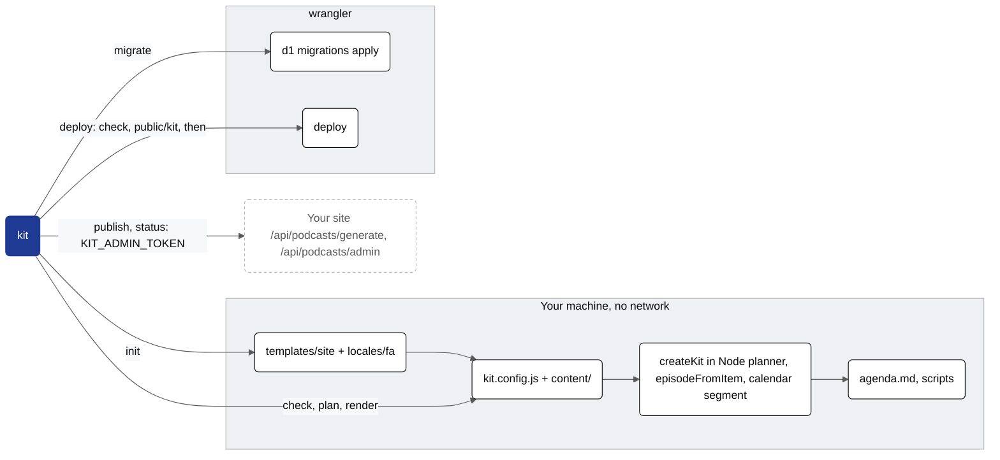
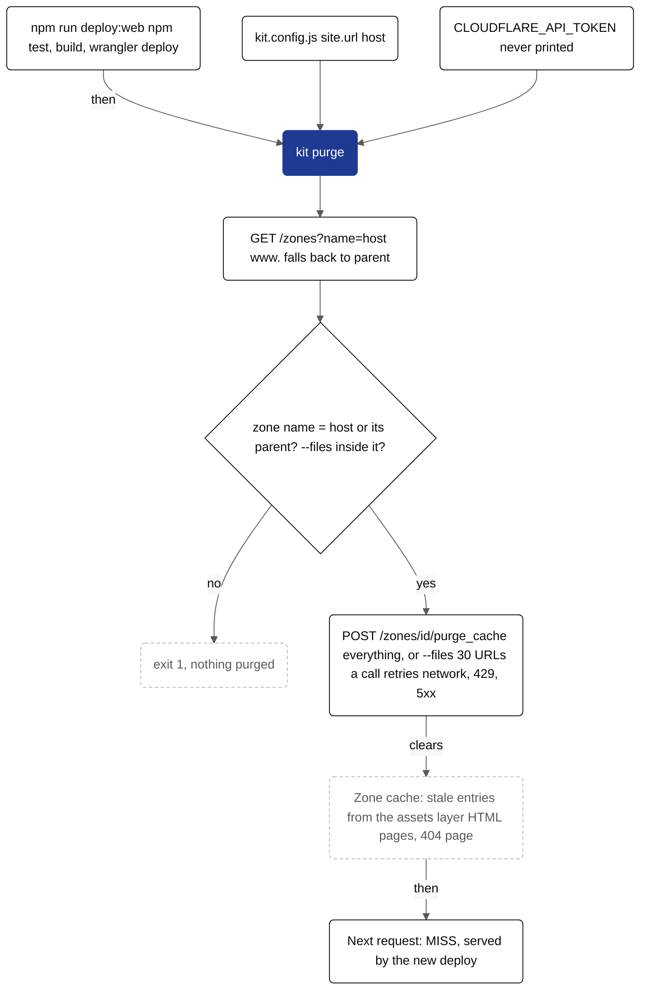

# @saasreport/cli

`kit`, the command line of a kit site: create a site from the starter template, check the content pack, plan a year of
publishing, preview episode scripts, queue episodes on the live site and run D1 migrations and deploys through wrangler.
Node ≥ 20, no dependencies beyond the kit packages. License: Apache-2.0.

```sh
npx kit init my-site              # English, LTR, Gregorian   (--locale fa: Persian, RTL, Jalali)
cd my-site && npm install
npx kit check                     # config + content contracts, exit 1 on problems
npx kit plan                      # agenda.md: a dry run of the next 371 days, exit 1 on gaps or broken items
npx kit render weekly 2026-09-28  # one episode script with its estimated duration
npx kit migrate                   # D1 migrations, local (--remote for Cloudflare)
npx kit deploy                    # check, refresh client assets, wrangler deploy
CLOUDFLARE_API_TOKEN=… npx kit purge   # after a deploy: purge the edge cache of site.url's zone
KIT_ADMIN_TOKEN=… npx kit publish daily inflation --force
KIT_ADMIN_TOKEN=… npx kit status term-inflation
```

## Where each command acts


<details><summary>Mermaid source (kit.packages.cli.readme.1)</summary>



</details>

`check`, `plan` and `render` load the project the way the Worker does: `kit.config.js` (validated by `defineConfig`),
`content/index.js` plus any `series[].source` modules, and episodes built by `@saasreport/cloudflare`'s `createKit` (so a
weekly episode includes the same spoken calendar segment the cron would publish). Nothing touches the network.

## Commands

| command | does | exit 1 when |
| --- | --- | --- |
| `kit init [dir] [--locale en\|fa] [--name n] [--force] [--link]` | copies `templates/site` (overlaying `locales/fa` for `--locale fa`), names the Worker, D1 database and R2 bucket after the directory, writes the client assets to `<assets dir>/kit/` (`writeAssets` from `@saasreport/cloudflare/assets-manifest`). `--link` symlinks `node_modules/@saasreport/*` to the packages next to this CLI (working on kit itself, offline tests) | the directory is not empty (without `--force`), unknown locale |
| `kit check` | `defineConfig` + `checkContent`, prints a summary | any config or content problem (all are listed) |
| `kit check persian [--json]` | lints the project's Persian sources (persian.config.json) and every podcast script the cron would voice with the Persian rule pack of `@saasreport/fa-lint`; also a step of `kit check canon` ([PERSIAN.md](../../docs/PERSIAN.md)) | an error finding, a stale exclude or allow entry, a fa project without `persian` |
| `kit check fa-review` | the deploy gate: every Persian source's content hash matches its entry in fa-review.json (approved by a listed native reader, or baseline) | a file changed since its last review, an approval by someone who is not a reviewer |
| `kit persian fix [--write] [--log f.json] [files…]` | applies the safe typography fixes (ZWNJ, ی/ک, punctuation, comma before و/یا) to the sources, in place; logs old → new | config problems |
| `kit persian review` · `approve --by <reviewer> files…\|--all` · `baseline` | lists review states; records a native reader's approval; records never-reviewed files as baseline | `--by` is not a listed reviewer |
| `kit plan [--from YYYY-MM-DD] [--days 371] [--out agenda.md] [--json]` | `agenda` from `@saasreport/core` with every episode script: writes the Markdown agenda (`--out -` prints it, `--out false` skips it), prints per-series counts and durations; `--json` prints `{ stats, problems, items }` with each item's episode (slug, title, summary, lines) | a slot without content, a broken post, an unspeakable line, an episode over its show's budget |
| `kit render <series> <ref> [--speakable] [--json]` | prints the episode script (`ref`: a date for topic series, `YYYY-MM` for reports, a term slug or entry slug for term series) and its estimated duration against `maxSeconds`; `--speakable` shows the text as the TTS receives it | unknown series or item, estimate over the limit |
| `kit publish <series> <ref> [--force] [--dry-run] [--url]` | `POST /api/podcasts/generate {series, ref, force}` on the site with `Authorization: Bearer $KIT_ADMIN_TOKEN` (queues the PodcastWorkflow run; `--force` re-renders an existing episode) | no token, unknown item, the API refuses (the reason is printed) |
| `kit status [slug] [--json] [--url]` | `GET /api/podcasts/admin[/<slug>]`: recent episodes and their states, or one episode with its workflow status | no token, the API refuses |
| `kit migrate [--remote] [--database name] [--dry-run]` | prints and runs `wrangler d1 migrations apply <database_name of DB> --local\|--remote` | wrangler fails |
| `kit deploy [--env name] [--dry-run]` | `kit check`, refreshes `<assets dir>/kit/`, prints and runs `wrangler deploy` | check problems, wrangler fails |
| `kit purge [--files <url,…>] [--dry-run]` | purges the Cloudflare edge cache of the zone serving `site.url` (see [After a deploy](#after-a-deploy-kit-purge)); everything by default, `--files` only those URLs or paths | no `CLOUDFLARE_API_TOKEN`, no zone for the host, a URL outside the zone, the API refuses (after retries) |
| `kit site build [--config site.config.js] [--out dir] [--check]` | the landing page per locale and the theme CSS from an `@saasreport/site` project; `--check` compares with the files on disk and writes nothing | project problems; `--check`: a file differs or is missing |
| `kit site check [--config site.config.js]` | validates tokens, locale packs and content of the site project | any problem |
| `kit plugin new <prefix> --skills <prefix>-a,… [--mcp name=url \| --api url] [--dir plugins/<prefix>] [--force]` | scaffolds an agent plugin (`@saasreport/plugins`): a Claude Code plugin whose skills write `./<prefix>-out/<skill>/<run-id>/` and `compile-report.json`, with the runtime and checker copied in | prefix outside the naming constitution, skill or server without the prefix, an existing plugin (without `--force`) |
| `kit plugin check [dir] [--prefix p] [--server name=url]` | validates a plugin: manifest, skill frontmatter, prefixed names, Inputs section, output folder, MCP server, runtime copies | any problem (all are listed) |
| `kit diagrams derive [--config site.config.js] [--check]` | writes `docs/diagrams/theme.init`, the project's diagram theme, from the site project's brand tokens ([DIAGRAMS.md](../../docs/DIAGRAMS.md)) | no tokens or font file; `--check`: the file differs |
| `kit diagrams theme` | rewrites every `docs/diagrams/*.mmd` and Markdown mermaid block to `theme.init` (init line, theme classes) | no `theme.init` |
| `kit diagrams render [files…] [--all] [--mermaid p] [--playwright dir] [--chromium p]` | themes, then renders stale `.mmd` files (or those given, or all) to PNGs stamped with the source's SHA-256; bundled Mermaid + local Chromium, the theme's font, no network | a diagram does not parse, a font does not load |
| `kit diagrams check` | checks every diagram against `theme.init` and every PNG against its source; for `npm test` | an init line or theme class differs, a colour outside the theme in a style line, a PNG missing or older than its source |

Common options: `--cwd <dir>` (`-C`), `--config <file>` (default `kit.config.js`), `--help`, `--version`.
Environment: `KIT_ADMIN_TOKEN` (the Worker's `ADMIN_TOKEN` secret), `CLOUDFLARE_API_TOKEN` (`kit purge`), `KIT_SITE_URL` (instead of `site.url`, e.g. staging or
`http://localhost:8787`). wrangler is the project's own `node_modules/.bin/wrangler` when installed, otherwise `npx wrangler`.

## After a deploy: `kit purge`

The Workers static-assets layer stores what it serves (HTML pages, the 404 page, `/kit/*`) in the zone's edge cache, and
those entries outlive a `wrangler deploy`: right after a deploy, a page or a path that was a 404 before can keep coming back
as `cf-cache-status: HIT` with the old content. Responses the Worker builds itself (feeds, `.ics`, APIs) are not cached
this way. `kit purge` clears the zone once the deploy is done:

```sh
"deploy:web": "npm test && npm run build && wrangler deploy -c wrangler.toml && kit purge"
kit purge --files /calendar/,/calendar/sa.ics   # only these (paths resolve against site.url)
kit purge --dry-run                             # zone lookup only (read-only); prints the purge it would send
```

- **Zone**: the host of `kit.config.js` `site.url`, looked up by name (`GET /zones?name=`); a `www.` host falls back to its parent.
- **Guard**: the zone found must be that host or its parent, and every `--files` URL must be inside it, so a shared
  account never purges another project's zone. No setting or cache rule is touched: the command only purges.
- **Token**: `CLOUDFLARE_API_TOKEN` with *Zone · Cache Purge* and *Zone · Zone · Read*. It is never printed (API messages are redacted).
- **Failures**: network errors, 429 and 5xx are retried (3 attempts, backoff); an API refusal exits 1.


<details><summary>Mermaid source (kit.packages.cli.readme.2)</summary>



</details>


## Programmatic use

```js
import { main, loadProject, runtime } from "@saasreport/cli";
const code = await main(["plan", "--json"], { cwd, env, out: console.log, err: console.error, fetch, spawn });
const project = await loadProject("./my-site");                // { config, content, dir }
const { plan, episode } = runtime(project);                     // the Worker's planner and episode builder, in Node
episode("weekly", plan.find("weekly", "2026-09-28")).lines;
```

## Tests

```sh
node --test packages/cli/test/*.test.mjs
node packages/cli/scripts/e2e-local.mjs [--locale fa]   # kit init → migrate → wrangler dev --local → curl; local only
```

`test/cli.test.mjs` covers every command (`migrate` and `deploy` only with `--dry-run`; `publish` and `status` against a
local fake admin API). `test/saasreport-parity.test.mjs` replays `examples/saasreport` against the legacy implementation in `/.legacy`
when it is present (see `examples/saasreport/README.md`).

## Several languages

`kit init my-site --locales en,ar` scaffolds a bilingual site (English at `/`, Arabic at `/ar/`; `ar,en` makes Arabic the
default): localised config values, content keyed per locale (`content/ar/…`) and an Arabic landing (`public/ar/index.html`).
`kit check` validates every locale (problems prefixed `[ar]`); `kit plan` writes one agenda section per locale;
`--locale ar` selects one locale for `plan`, `render`, `publish` and `status` (the admin API is under `/ar/api/…`).
