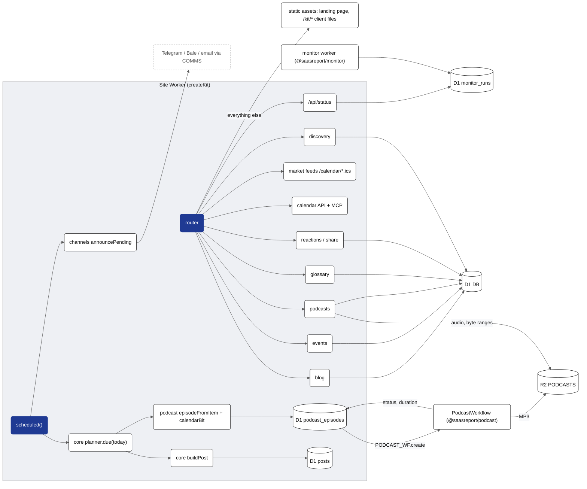
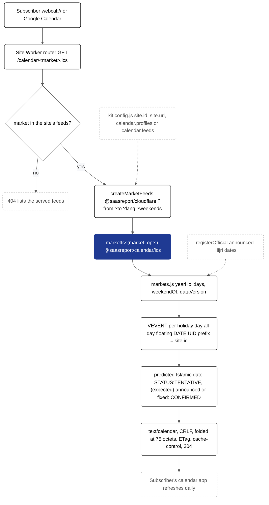

# @saasreport/cloudflare

The kit runtime on Cloudflare Workers: one `createKit(config, content)` call gives a Worker that serves the blog, events,
podcasts, glossary, reactions and share buttons, the calendar API + MCP server, discovery files (robots, sitemap, llms.txt,
security.txt) and `/api/status`, and runs the daily publishing cron. Everything project-specific — names, texts, colours,
URLs, shows, hosts, series — comes from `kit.config.js` and the content pack. Persian (RTL, Jalali) and English (LTR,
Gregorian) are both first-class. License: Apache-2.0.

## The worker (5 lines)

```js
import { createKit } from "@saasreport/cloudflare";
import config from "./kit.config.js";
import content from "./content/index.js";   // { [seriesId]: items | { categories, terms } }; or omit and use series[].source
const kit = createKit(config, content);
export default kit; export const PodcastWorkflow = kit.PodcastWorkflow;
```

`createKit(config, content?, options?)` returns `{ fetch, scheduled, runDaily, PodcastWorkflow, handlers, config }`.
`config` is validated by `@saasreport/core` `defineConfig()` (a bad config throws with every problem listed).

## How it fits together


<details><summary>Mermaid source (kit.packages.cloudflare.readme.1)</summary>



</details>

### Market holiday feeds

Independent of the `calendar` feature (the Iranian engine's API), so a market site with its own calendar API can keep
`features.calendar: false` and still serve feeds. The engine side is `marketIcs()` in `@saasreport/calendar/ics`.


<details><summary>Mermaid source (kit.packages.cloudflare.readme.2)</summary>



</details>

## Bindings, secrets and vars

| name | kind | used for |
| --- | --- | --- |
| `DB` | D1 | posts, events, podcast episodes, reactions, leads (optional), monitor runs — apply `migrations/` |
| `PODCASTS` | R2 | episode audio at `podcasts/<slug>.mp3` (+ temporary chunks written by the workflow) |
| `AI` | Workers AI | article → conversation scripts in `@saasreport/podcast` (optional) |
| `PODCAST_WF` | Workflow (`class_name = "PodcastWorkflow"`) | one durable run per episode (script → TTS → MP3 → publish) |
| `COMMS` | service binding (optional) | event RSVP acknowledgements and email announcements (`@saasreport/channels`) |
| `ASSETS` | static assets | the landing page, `/kit/*` client assets, anything the router does not own |
| `ADMIN_TOKEN` | secret | `Authorization: Bearer …` for `/api/podcasts/generate` and `/api/podcasts/admin*` (`PODCAST_ADMIN_TOKEN` also accepted) |
| `IP_SALT` | secret | salt for hashed visitor ids and IPs (reactions, RSVP rate limit) |
| `GEMINI_API_KEY` or `TTS_URL` + `TTS_SIGNING_KEY` / `HF_TOKEN` | secret / var | speech (see `@saasreport/podcast`); without them no episode is queued |
| `TELEGRAM_BOT_TOKEN`, `TELEGRAM_CHAT_ID`, `BALE_*`, … | secret / var | announcements (see `@saasreport/channels`); dormant when unset |
| `PODCAST_OWNER_EMAIL` | var (optional) | `<itunes:owner>` in podcast feeds (or `shows.<id>.ownerEmail`) |

Storage binding names can be changed with `createKit(config, content, { storage: { db, bucket, ai } })` (passed to the workflow).

## wrangler.toml

```toml
name = "my-site"
main = "src/worker.js"
compatibility_date = "2026-09-01"
compatibility_flags = ["nodejs_compat"]

[assets]
directory = "./public"          # landing page + the kit assets copied to ./public/kit/
binding = "ASSETS"
run_worker_first = true

[[d1_databases]]
binding = "DB"
database_name = "my-site"
database_id = "<id from `wrangler d1 create my-site`>"
migrations_dir = "node_modules/@saasreport/cloudflare/migrations"

[[r2_buckets]]
binding = "PODCASTS"
bucket_name = "my-site-podcasts"

[ai]
binding = "AI"

[[workflows]]
name = "my-site-podcast"
binding = "PODCAST_WF"
class_name = "PodcastWorkflow"

# [[services]]
# binding = "COMMS"
# service = "my-comms-worker"

[triggers]
crons = ["30 2 * * *"]           # the daily run; any time before the series' `at` (06:00 Asia/Tehran = 02:30 UTC)

[vars]
TELEGRAM_CHAT_ID = ""
# secrets: wrangler secret put ADMIN_TOKEN | IP_SALT | GEMINI_API_KEY | TELEGRAM_BOT_TOKEN
```

## Routes

Every group is behind `config.features` (all on by default); a disabled feature answers 404 and leaves the nav.

| feature | routes |
| --- | --- |
| `blog` | `/blog/` (`?kind=`, `?page=`), `/blog/<slug>`, `/blog/<slug>.md`, `/blog/feed.xml`, `/api/blog/posts` |
| `events` | `/events/`, `/events/<slug>`, `/events/<slug>.ics`, `/events/<slug>/add` (Google / Apple / Outlook / Microsoft 365 chooser), `/api/events`, `POST /api/forms/event-rsvp` (only with `events.rsvp`) |
| `podcasts` | `/podcasts/` (a section `#<show>` per show), `/podcasts/<slug>` (player + transcript), `/podcasts/<slug>.md`, each show's `feed` and `/podcasts/<show>/feed.xml`, `/podcasts/audio/<slug>.mp3` (byte ranges), `/api/podcasts?series=&show=&limit=`, admin: `POST /api/podcasts/generate {series, ref, force?}` or `{post: <blog slug>}` (audio version of a post, scripted by Workers AI), `GET /api/podcasts/admin[/<slug>]` |
| `glossary` | `/glossary/` (taxonomy, filter, term of the day), `/glossary/<slug>` (DefinedTerm), `/glossary/<slug>.md`, `/api/glossary`, `/api/glossary/today`, `/taxonomy` → `/glossary/` |
| `reactions` | `GET/POST /api/reactions` — likes on posts and episodes, 1–5 ratings on episodes |
| `share` | share buttons under posts and episodes (`options.share.targets`) |
| `calendar` | `/api/calendar/*` (REST), `/api/calendar/openapi.json`, `POST /mcp` (MCP, read-only tools), `/calendar.ics` (Iranian holiday table only) |
| `feeds` | `/calendar/<market>.ics` for every market in `calendar.feeds` (default: the site's market profiles; `false` turns them off). `?from=&to=` Gregorian years (default this year and next, at most 6), `?lang=en\|ar\|fa`, `?weekends=1`. `text/calendar`, `cache-control: public, max-age=3600`, strong ETag (304 on `If-None-Match`), UIDs `<site.id>-<market>-…@<host>`; any other market answers 404 with the list of feeds. `kit.calendarFeeds()` → `[{ market, path, url, webcal }]` for subscribe links. |
| `sitemap`, `llms` | `/sitemap.xml`, `/llms.txt`, `/llms-full.txt` |
| `monitor` | `/api/status` (the monitor's status document, kit.monitor-status.v1, from the monitor Worker over the service binding `MONITOR`; never the monitor's D1; 503 with a reason code when unbound or unreachable) |
| always | `/robots.txt`, `/.well-known/security.txt`, `/api/health`, `www.` → apex redirect |

Pages carry canonical, Open Graph, Twitter and JSON-LD (Organization + WebSite from `site.org`, plus Blog/BlogPosting,
Event, PodcastSeries/PodcastEpisode, DefinedTermSet/DefinedTerm and BreadcrumbList).

## Daily cron

`scheduled()` runs `runDaily(env, { day })` for the local day of `event.scheduledTime` in `site.timezone`:

1. `planner(config, content).due(day)` (`@saasreport/core`).
2. Series with `post` (topic and report by default): `buildPost(plan, entry)` → upsert into `posts` with
   `published_at = entry.publishAt` (pages show it from then on). Weekly topics get the week's calendar tables, reports the month's.
3. Series with `podcast` (when TTS secrets are present): `episodeFromItem(config, series, item, { number, ref, calendarBit })`
   → row in `podcast_episodes` (`status = 'queued'`) → `PODCAST_WF.create({ params: { slug } })`. Existing episodes are not re-queued.
   Weekly topic episodes end with a short spoken calendar segment (`calendarBit`, strings `calbit.*`). Term episodes get the
   glossary categories, so their summary ends with `(category)`. A project supplies its own calendar segment with
   `series[].podcast.calendarBit` in `kit.config.js` (the Worker and `kit plan` / `kit render` use it) or `options.calendarBit`
   (every weekly series): `({ item, series, config, calendar, t, day, fallback }) → { lines: [[speaker, text]], summary? } | null`,
   where `calendar` is `@saasreport/calendar`, `day` the day number of `item.date` and `fallback()` the generic segment.
4. `announcePending(env, config)` (`@saasreport/channels`) announces new posts, events and published episodes once.

`runDaily` is idempotent; the report `{ posts, episodes, skipped, errors, channels }` is logged.

## Worker-only options

`createKit(config, content, options)` — kept out of `kit.config.js` because `defineConfig` validates its keys:

```js
createKit(config, content, {
  share: { targets: ["native", "telegram", "whatsapp", "x", "linkedin", "copy"] },   // also "facebook", "email", or
                                                                                     // { key, label, url: "https://…?u={url}&t={title}" }
  reactions: { cookie: "kit_v", salt: "…", windowMinutes: 10, maxWrites: 60, ratings: ["episode"] },   // salt: fallback when IP_SALT is unset
  events: { rsvp: false, rsvpForm: "event-rsvp", privacyUrl: "/privacy", lead: "…", og: { image, alt }, itemOg: { image }, publicJoinUrl: false },
  blog: { perPage: 12, kinds: ["article", "howto", "analysis", "topic", "report", "snapshot"], lead: "…", name: "…", feedDescription: "…",
          author: "…",            // byline of scheduled posts (JSON-LD names the organization for it)
          og: { image, alt }, itemOg: { image }, tocAllLevels: false },
  podcasts: { lead: "…", cover: { src, width, height, alt }, og: { image, alt }, itemOg: { image }, crumbShow: true },
  glossary: { lead: "…", name: "…", og: { image, alt }, itemOg: { image } },
  nav: [{ href: "/calendar/", label: "Calendar", sitemap: { changefreq: "monthly", priority: "0.7" } }],   // sitemap: false leaves it out
  footer: { links: [{ href: "/privacy", label: "Privacy" }], items: [["/", "Home"], …] /* replaces the default list */, note: "© {year} {name}. {rights}" },
  shell: { logo: { src, width, height, alt }, head: "<link rel=…>", stylesheets: [], scripts: [], fonts: true,
           robots: "index, follow, max-image-preview:large", og: { image, width, height, type, secure } },
  subscribe: { form: "newsletter", title, note, button, done, privacyUrl, events: { title, note } },   // sign-up box → POST /api/forms/<form>
  api: { blogPosts, events, podcasts, glossary, glossaryToday },    // (payload, { url, env, k, rows… }) → payload: keep an existing JSON contract
  llms: { build: (ctx) => "…", source, glossarySource, relatedLabel, relatedSep, transcriptHeading },
  security: { contact: "mailto:security@example.org", policy: "https://example.org/security", about: "…", disallow: [], aiBots: true,
              robotsComment: "…", aiComment: "…", aiDisallow: ["/api/forms/"] },
  assets: { base: "/kit" },
  storage: { db: "DB", bucket: "PODCASTS", ai: "AI" },
  calendarBit: (ctx) => ({ lines: [["host", "…"], ["expert", "…"]], summary: "…" }),   // or series[].podcast.calendarBit
  deps: { /* override any wired dependency, e.g. planner, announcePending */ },
});
```

Section wording comes from strings (all optional but the title): `<section>.eyebrow`, `.heading`, `.lead` / `.leadHtml`, `.note`,
`.description` (meta), `.pageTitle` and `.itemTitle` (`"{title} | {site}"`) for `blog`, `podcasts`, `glossary` and `events`; plus
`blog.cardMeta`, `podcasts.cardMeta`, `podcasts.feedOf` (`{short}`), `podcasts.speakerSep`, `podcasts.section`, `podcasts.term` /
`podcasts.post` / `podcasts.article` (HTML with `{slug}`, `{name}`), `glossary.listen`, `glossary.episodeLink`, `glossary.soonOn`,
`glossary.todaySoon`, `events.emptyNote`, `events.rsvpButton`. Show keys used by the pages and feeds: `heading`, `cadence`, `badge`,
`badgeClass`, `duration` (`"clock"` | `"minutes"`), `limit`, `itemTitle` (`{title} {show} {short} {term}`), `empty`, `more` (HTML),
`cover1400`, `guidPrefix` (episode guids; keep it once published). `brand.fonts.faces: [{ family, src, weight, format }]` self-hosts fonts.

## Strings and brand

- UI strings have `fa` and `en` defaults (`STRINGS` in `src/strings.js`, dotted keys such as `blog.title`, `rx.like`,
  `glossary.whatIs`). Override in `config.strings` flat (`{ "blog.title": "Notes" }`) or per language (`{ en: { … } }`).
  Report and calendar texts come from `@saasreport/core` strings; podcast intros/outros from `@saasreport/podcast`.
- `config.brand.colors` and `config.brand.fonts` become CSS custom properties after `kit.css`:
  `colors.accent → --accent`, `colors.ink → --ink`, `colors.surface → --surface`, `fonts.body → --font-body`,
  `fonts.href` → a stylesheet link. Tokens used by `kit.css`: `--accent --accent-ink --ink --muted --bg --surface --sink --wash
  --line --line-2 --rail --err --ok --radius --font-body --font-mono`.
- `<html lang dir>` come from `site.locale` / `site.dir`; dates are formatted in `site.timezone`; for
  `calendar.system = "jalali"` the year, month and day come from `@saasreport/calendar`'s arithmetic (`formatJalali`) in a
  Gregorian Intl layout, never ICU's Persian calendar (a day off on Workers in 1405); digits follow the language.

## Client assets

The pages load `${assets.base}/kit.css`, `kit.js` (toasts, copy link, native share, likes/ratings, RSVP form),
`podcast.js` (player, transcript follow) and `glossary.js` (filter), all versioned with `?v=`. They are **not embedded in the
Worker**: the CLI copies them into the static assets directory, together with browser copies of the calendar engine and the
`<…-date-picker>` web component:

```js
import { writeAssets } from "@saasreport/cloudflare/assets-manifest";   // Node only
await writeAssets("public/kit");   // kit.css kit.js podcast.js glossary.js calendar.js hijri.js datepicker.js
```

Hooks the client scripts and `@saasreport/monitor` rely on: `[data-rx]`, `[data-share]`, `[data-copy-url]`, `[data-pp]`,
`[data-transcript]`, `[data-gsearch]`, `[data-gterm]`, `[data-gcat]`, `[data-glossary-today]` / `[data-glossary-empty]`,
`#<show id>` sections on `/podcasts/`.

## Migrations

`migrations/` (apply with `wrangler d1 migrations apply DB` or `kit migrate`):

| file | tables |
| --- | --- |
| `0001_posts_events.sql` | `posts` (free-text `kind`: topic, report, term, article, …; `series`), `events` |
| `0002_podcast_episodes.sql` | `podcast_episodes` (`series`, `show`, free-text `kind` / `source_type`, per-series numbers) |
| `0003_reactions.sql` | `reactions` (item, hashed visitor, like, rating, hashed IP) |
| (0004, removed) | `monitor_runs` no longer lives in the site's DB: the monitor writes to its own D1 (`@saasreport/monitor` migrations). A site that applied 0004 keeps the unused table until the owner archives and drops it (docs/RESILIENCE.md, migration path). |
| `0005_leads.sql` | `leads` (optional; event RSVP) |

`posts`, `events` and `podcast_episodes` carry `channel_state` / `channel_ref` for `@saasreport/channels`.

## Testing without Workers

`buildKit(config, content, { deps, now })` (`@saasreport/cloudflare/kit`) takes every dependency injected and a clock.
The tests run the Worker in Node against an in-memory D1 (`node:sqlite` with the migrations applied), a fake R2 bucket and a
fake Workflow binding, for an `fa-IR` RTL Jalali site and an `en-US` LTR Gregorian site:

```sh
node --test packages/cloudflare/test/*.test.mjs
```

## Multi-locale sites

With `site.locales` (see @saasreport/core), `createKit` returns a router over one runtime per locale: `/` is the default locale,
`/ar/…` the ar runtime (which sees the path without `/ar`). Pages link under the prefix, set `<html lang dir>`, JSON-LD
`inLanguage`, hreflang alternates on section pages and a language switcher. `/sitemap.xml` (with `xhtml:link` alternates) and
`/llms.txt` cover every locale; each locale has its own blog RSS and one feed per show. `options` may carry localised values too.

Storage: `migrations/0006_locale.sql` adds `locale` (posts, podcast_episodes, events) and keeps every row; `''` is the default
locale. Another locale's rows store `ar/<slug>` (R2 audio at `podcasts/ar/<slug>.mp3`), and `/blog/ar/<slug>` redirects to
`/ar/blog/<slug>`. The cron publishes each locale, then announces once; one PodcastWorkflow serves all locales (payload
`{ slug, locale }`). A single-locale site never reads or writes the locale column. Strings: en, fa, ar.

## Markdown twins, `/api/meta` and webhooks

- **Twins** (`src/twins.js`): `GET /<path>/index.md` or `/<path>.md` is served from the static assets as
  `text/markdown; charset=utf-8` with a canonical `Link` to the HTML page and `x-robots-tag: noindex`; `/llms.txt` gets a
  "Pages (Markdown)" section from `md-twins.json`, `/llms-full.txt` their full text. `options.llms.build` receives
  `pages` and `pageDocs`. Opt out with `llms: { pages: false }`.
- **`GET /api/meta`** (`kit.api-meta.v1`, `src/handlers/meta.js`): forms (the kit's `event-rsvp` plus
  `meta: { forms: { <id>: { fields: [{ key, required, max, type, label }] } } }`), required fields, consent and honeypot,
  and the public APIs. `meta: false` turns it off.
- **Webhooks** (`@saasreport/cloudflare/webhooks`, Workers class in `@saasreport/cloudflare/webhooks-workflow`):
  `enqueueWebhooks(env, event, { webhooks })` queues one `WebhookWorkflow` instance per subscriber
  (`webhooks: { subscribers: [{ id, urlEnv, keysEnv, types }] }`, keys `"kid:secret,kid2:secret"` in a secret), retried
  with exponential backoff; `intakeWebhook()` verifies an upstream delivery and turns it into relayed + normalised events.

```toml
[[workflows]]
name = "<project>-webhooks"
binding = "WEBHOOK_WF"
class_name = "WebhookWorkflow"
```


## Content-Security-Policy (`@saasreport/cloudflare/csp`)

```js
import { defineCsp, withCsp, readCspReports } from "@saasreport/cloudflare/csp";
import cspConfig from "./csp.json" with { type: "json" };   // { "$schema": ".../schema/csp.schema.json", report, policies }
const csp = defineCsp(cspConfig);                             // throws, listing every problem, on an invalid file
// in fetch(): HTML gets a fresh nonce on every <script> and in the one CSP header
return withCsp(await env.ASSETS.fetch(request), csp, "site");
// the report endpoint: for (const v of await readCspReports(request)) console.warn(JSON.stringify({ event: "csp-violation", ...v }));
```

Also exported: `validateCsp`, `cspHeader`, `createNonce`, `addNonce` (string rewrite for Node previews), `nonceOf`,
`CSP_SCHEMA`. See docs/ARCHITECTURE.md, "Content-Security-Policy with a per-request nonce".

