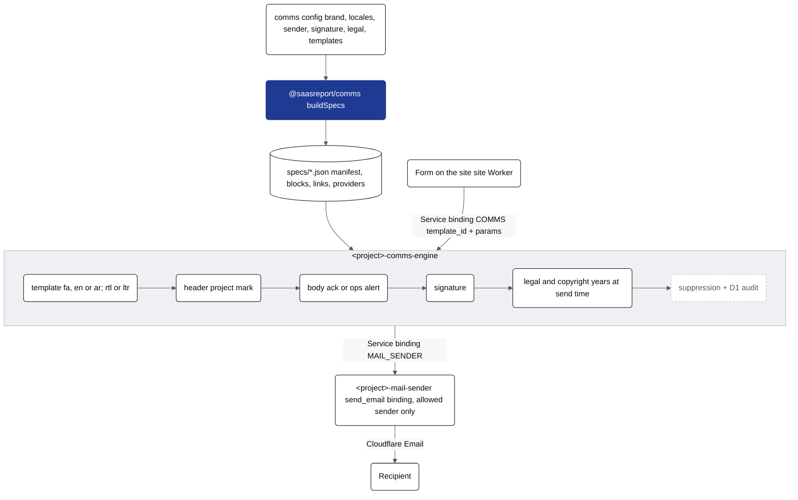
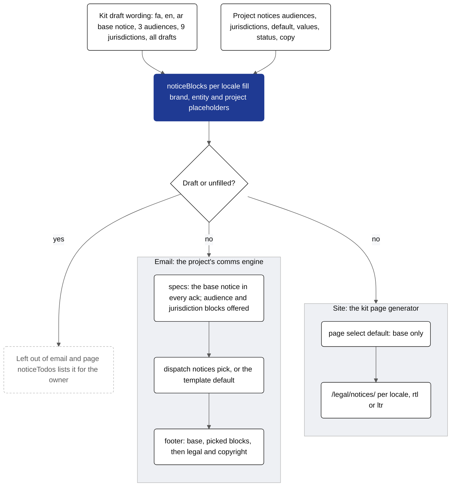

# @saasreport/comms

A project's outbound email on Cloudflare, from one **comms config**: the comms-engine spec files, the two
Workers that send them (`<project>-comms-engine` and `<project>-mail-sender`), their `wrangler.toml`, and HTML
previews. Every email has the same layout (phone-safe: below 620px the header hides the domain and every row narrows its padding): the project's header mark, the body, a standard signature, and a
legal and copyright footer. Locale packs for Persian (`fa`, RTL, Solar Hijri year), English (`en`, LTR) and
Arabic (`ar`, RTL, formal MSA, optional lunar Hijri year) are built in.


<details><summary>Mermaid source (kit.packages.comms.readme.1)</summary>



</details>

## Use

```js
import { buildSpecs, templateId, todos } from "@saasreport/comms";
import { writeSpecs, writeWrangler, writePreviews } from "@saasreport/comms/node";
import config from "./comms.config.js";

writeSpecs(config, "workers/comms-engine/specs");           // manifest, blocks, links, providers (.json)
writeWrangler(config, { "comms-engine": "workers/comms-engine/wrangler.toml", "mail-sender": "workers/mail-sender/wrangler.toml" });
writePreviews(config, "previews");                         // <template_id>.html + .txt per template and locale
todos(config);                                             // [path, "TODO: …"]: what the project still has to fill in
templateId(config, "contact", "ar");                       // "<idPrefix>.contact.ack.ar.v1"
```

The two Worker entries are a few lines each:

```js
// workers/comms-engine/src/index.js
import { createCommsEngine } from "@saasreport/comms/engine";
import config from "../../../comms.config.js";
import manifest from "../specs/manifest.json";
import blocks from "../specs/blocks.json";
import links from "../specs/links.json";
import providers from "../specs/providers.json";
const engine = createCommsEngine({ config, specs: { manifest, blocks, links, providers } });
export const dispatchCore = engine.dispatchCore;
export default { fetch: engine.fetch };

// workers/mail-sender/src/index.js
import { createMailSender } from "@saasreport/comms/mail-sender";
import { mailSenderOptions } from "@saasreport/comms";
import config from "../../../comms.config.js";
export default createMailSender(mailSenderOptions(config));
```

The engine's D1 tables are in `migrations/0001_comms.sql`. The site Worker calls the engine over a Service
binding (`COMMS`): `POST /v1/comms/dispatch { template_id, to, params, idempotency_key }`. Params ending in
`_html` are trusted fragments (build `fields_html` with `fieldsHtml(rows, { dir })`); every other param is escaped.

## The comms config

| key | what |
| --- | --- |
| `project` | Worker name prefix: `<project>-comms-engine`, `<project>-mail-sender` |
| `idPrefix` | template, block, registry and audit ids (`<idPrefix>.<form>.ack.v1`, `<idPrefix>.comms.dispatched.v1`) |
| `site`, `locales`, `timeZone` | site URL; locale tags, the first is primary (others get `.<lang>` ids); zone for the copyright years |
| `brand` | `name` per locale, `domain`, `logo` (PNG `{ src, width, height }`, or `null` for a wordmark), `colors` (or `colorsFromTokens(siteTokens)`), `fonts` per locale (`stack`, self-hosted `faces`) |
| `sender` | `address` (the only address the mail-sender may use), `name` per locale, `replyTo` |
| `signature` | per locale: `tagline`, optional `team` and `closing` |
| `legal` | `entity: { name, address, registration }` (per locale or plain; an empty or `TODO…` value is left out of the footer and the brand stays the copyright holder), `hijri` (ar); the wording comes from the locale pack, or `legal.paragraphs[lang](x)`; `notices`: the legal notices by audience and jurisdiction (below) |
| `links` | `contact`, `privacy`, `unsubscribe` |
| `templates` | per form: `key`, extra `params`, `unsubscribe`, `copy[lang]: { subject, preheader, title, intro[], steps[], cta, extra }` |
| `ops` | operator notifications (`lead-alert`), in the primary locale unless `locale` is set |
| `manifest`, `workers` | registry metadata (`adopted`, `frameworkRefs`); compatibility dates, D1 and KV bindings |

Copyright years are computed by the engine at send time, per locale pack: `${year_fa}` (Solar Hijri) and
`${year_en}` in Persian digits for `fa`; `${year}` for `en`; `${year_ar}` and `${year_hijri}` (Umm al-Qura) in
Arabic-Indic digits for `ar`.

## Legal notices by audience and jurisdiction

A base notice plus optional blocks keyed by **audience** (`retail`, `professional`, `institutional`) and by
**jurisdiction** (`IR`, `SA`, `AE`, `GB`, `EU`, `US`, `SG`, `MY`, `ID`, or a project's own code with its own copy).
The kit ships plain-language drafts in fa, en and ar (`src/notices/`): informational only; not investment, legal,
tax or Shariah advice; no offer or solicitation; who the material is for; figures and illustrations are examples.
They claim no licence, registration or regulatory status.

```js
legal: {
  entity: { name, registration, address },              // fills {{legal_entity}}, {{registration}}, {{registered_address}}
  notices: {
    audiences: ["institutional"],                       // blocks the project offers
    jurisdictions: [],                                  // e.g. ["GB"]; drafts until counsel signs off
    default: { audiences: [], jurisdictions: [] },      // what a recipient gets without a pick: the base only
    values: { audience_gb: "…", regulatory_statement_gb: "…" },
    status: { GB: "approved by counsel, <date>" },      // replaces the kit's "draft — needs counsel review"
    copy: { en: { base: { title, paragraphs }, audiences: { … }, jurisdictions: { … }, page: { … } } },
  },
},
templates: [{ key: "contact", notices: { audiences: ["institutional"] }, … }],   // a template's own default
```

- Every acknowledgement gets the base notice above the legal footer; the picked audience and jurisdiction blocks
  follow it. A recipient picks at dispatch: `POST /v1/comms/dispatch { …, notices: { audiences, jurisdictions } }`
  (an unknown pick is a 400 `unknown_notice`). Internal ops alerts carry no notices.
- **Never published:** a jurisdiction block whose status starts with `draft` (every kit jurisdiction, until the
  project records counsel's sign-off in `status`) and any paragraph with an unfilled `{{placeholder}}`.
  `renderPreviews(config, { drafts: true, placeholders: "show", notices })` shows them in a local preview only.
- `noticeTodos(notices, langs, { brand, site, entity })` lists every unfilled placeholder and draft status for the
  owner; `noticePlaceholders()` lists every placeholder the kit wording uses.
- The same object renders the site page `/legal/notices/` (`@saasreport/site`, page type `notices`), per locale.


<details><summary>Mermaid source (kit.packages.comms.readme.2)</summary>



</details>

## Examples

- [`examples/saasreport`](examples/saasreport/comms.config.js): SaasReport (en).
- [`examples/saasreport-ar`](examples/saasreport-ar/comms.config.js): SaasReport (en + ar, right-to-left).
- `node packages/comms/examples/render.mjs <out>` renders every template of both, per locale, and lists each
  config's TODOs. Arabic strings marked `review` need a native editor's check.

## Events and required params

`GET /v1/comms/manifest` lists each template's `required_params`. `createCommsEngine({ ..., onEvent(type, data, env, ctx) })`
receives `comms.dispatched`, `comms.failed` and `comms.suppressed` with ids, template, channel, category and counts (never
an address); wire it to `webhookEvent` + `enqueueWebhooks` for outbound webhooks. A failing hook never fails a send.
Threat model: [docs/THREAT_MODEL.md](../../docs/THREAT_MODEL.md) (draft).

## Forms: the receipt and the owner's notification

Every form the config declares (`forms`, kit.forms-config.v1; default: every template) is delivered by the engine through
`POST /v1/comms/submit` only: the submitter's receipt and the owner's notification (recipients: the engine secret
`forms.owner.secret`), both recorded in `comms_form_deliveries` (migration 0003). A site's handler calls `submitForm(env, submission, { site })`
and never dispatches a form's template itself (refused, 409). Gates, ledger and monitor journeys: [docs/FORMS.md](../../docs/FORMS.md).
