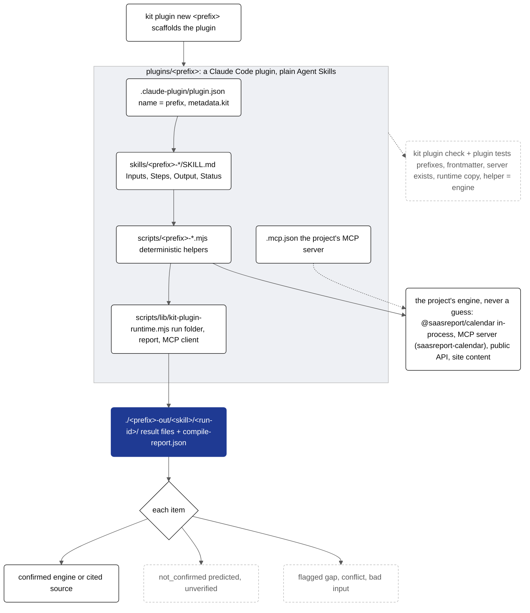

# @saasreport/plugins

Agent plugins for kit projects, after the LegalQuants pattern: small, named, prefix-scoped skills that each write real
working files into a fixed folder with a compile report and honest statuses, on top of the project's own engine, MCP
server or public API. Each plugin is a [Claude Code plugin](https://code.claude.com/docs/en/plugins-reference)
(`.claude-plugin/plugin.json`, `skills/<name>/SKILL.md`, optional `commands/` and `.mcp.json`), and every skill is a
plain [Agent Skills](https://agentskills.io) file plus a Node script, so other agent runtimes can use the same files.


<details><summary>Mermaid source (kit.packages.plugins.readme.1)</summary>



</details>


## The convention

| Rule | What it means |
| --- | --- |
| Name | The plugin `name` is the project code from the registry (`packages/core/registry/projects.json`: the short prefix without its dash, or the key when there is none; the checker's `PREFIXES` is generated from it). Skills and commands start with `<prefix>-`; an MCP server is named `<prefix>`, `<prefix>-…` or with the full project prefix (`saasreport-calendar`). |
| Inputs | Every SKILL.md has an `## Inputs` section; the skill asks for a missing input instead of guessing it. |
| Output | `./<prefix>-out/<skill>/<run-id>/` (run id: `20261001T120000Z-<8 hex of the inputs>`), the result files and `compile-report.json`. |
| Report | `kit.compile-report.v1` ([schema](schema/compile-report.schema.json)): inputs, engine (`via`: engine, mcp, api, content), outputs with sha256, and items with `status` and `sources`. |
| Statuses | `confirmed`: backed by the engine or a cited source, nothing predicted (needs at least one source). `not_confirmed`: depends on a prediction or an unverified source, or has none. `flagged`: needs a person (a known data gap, sources that disagree, invalid input, an unverified citation). Both need a `note`. The report's `status` is the worst item. |
| Computation | Helpers call the engine, the MCP server or the API; the model never computes dates, counts or citations itself. |
| Backend | `metadata.kit.backend` in plugin.json: `mcp` (with `.mcp.json` pointing at the project's own server), `api` or `engine` (each with a note saying why there is no MCP server). |
| Runtime | `scripts/lib/kit-plugin-runtime.mjs` (createRun, item, file, finish, mcpCall, apiGet, engineStatus) and `scripts/lib/kit-plugin-check.mjs` (the validator, standalone: `node scripts/lib/kit-plugin-check.mjs <dir>`) are copied from [runtime/](runtime/) byte for byte, so a plugin runs and checks itself when installed on its own, and a project can test its plugin before its kit submodule includes this package. |

Calendar answers use `engineStatus({ uncertain, packStatus })`: a predicted lunar holiday that decides the result or an
unverified holiday pack gives `not_confirmed`; a partial pack (known gaps) gives `flagged`.

## Use

```bash
kit plugin new saasreport --skills saasreport-settlement,saasreport-glossary --mcp saasreport-calendar=https://saasreport.ai/mcp
kit plugin new acme --skills acme-holidays --api https://acme.example/api/calendar --dir plugins/acme
kit plugin check plugins/saasreport --prefix saasreport --server saasreport-calendar=https://saasreport.ai/mcp
claude plugin validate plugins/saasreport            # Claude Code's own manifest check
claude --plugin-dir plugins/saasreport               # then /saasreport:saasreport-settlement 1405/12/28 --t 1
```

```js
import { scaffoldPlugin, validatePlugin, validateReport } from "@saasreport/plugins";
validatePlugin("plugins/saasreport", { prefix: "saasreport", servers: { "saasreport-calendar": "https://saasreport.ai/mcp" } }); // → []
```

`validatePlugin` checks: the manifest (name = prefix, version, description, author, license, `metadata.kit`), each
skill's frontmatter (name = folder, `<prefix>-`, lowercase, ≤ 64 characters, a description of ≤ 1024 characters,
quoted when YAML would misread it), the `## Inputs` section, the output folder and report, the status words, every
`${CLAUDE_PLUGIN_ROOT}/…` path, command names, `.mcp.json` (prefixed names, https, credentials only as
`${ENV}`, and the server must be one the project runs when `servers` is given) and the runtime copy.

## Tests

`test/plugins.test.mjs` scaffolds a plugin with `kit plugin new`, validates it, and runs its helper end to end.

## Critic stage, risk and learnings

| Option | What it does |
| --- | --- |
| `createRun({ critic: true })`, `run.criticPass(fn)` / `run.critique(id, { verdict, note, risk })` | A second pass tries to falsify each `confirmed` item. `upheld` keeps it; `inconclusive` → `not_confirmed`; `refuted` → `flagged`; never checked → `not_confirmed`. A verdict never raises a status; `report.critic` counts them. |
| `risk` (1-10) on `flagged` items | 1-2 cosmetic, 3-4 low, 5-6 medium, 7-8 high, 9-10 critical; `summary.max_risk`. |
| `run.learn({ kind, text, item_id, tags, evidence })` | Appends to `./<prefix>-out/learnings.jsonl` ([`kit.plugin-learning.v1`](schema/learnings.schema.json)); kinds: false_positive, pattern, trajectory, gap, correction. |

`node scripts/lib/kit-plugin-check.mjs compile-report.json` or `… learnings.jsonl` validates one file.


