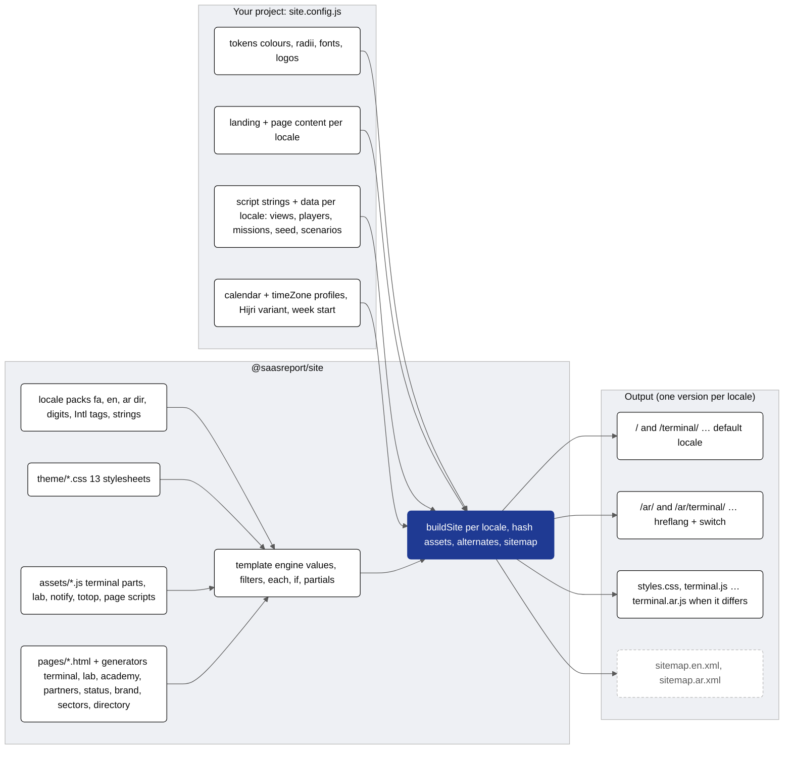
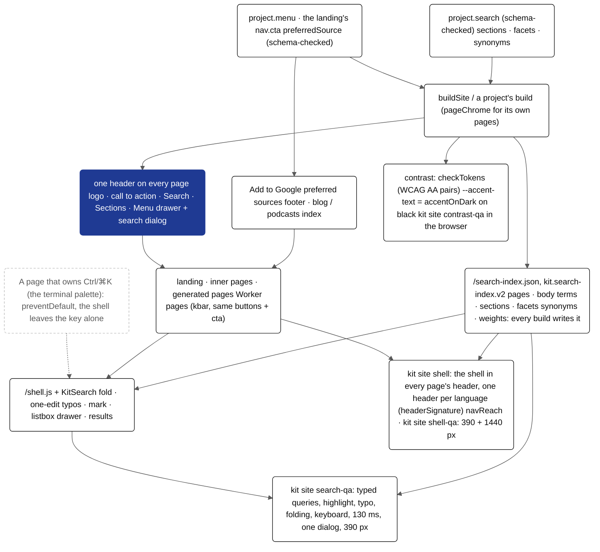

# @saasreport/site

The kit's site theme: the landing page and its chrome, the inner pages (terminal, lab, academy, partners, status, brand,
sectors, directory), the client scripts (the terminal and lab demo engines, notifications, back to top and the section
index, each page's script) and 13 theme stylesheets, generated from **design tokens**, **locale packs** (`fa`, `en`, `ar`),
**content** and **script strings and data** per locale. One version per locale, with `hreflang` alternates, a language
switch and a sitemap per locale.


<details><summary>Mermaid source (kit.packages.site.readme.1)</summary>



</details>

```js
import { buildSite, defineSite, createLocale } from "@saasreport/site";

const { files, sitemap } = buildSite(project, { root: process.cwd(), write: true });   // index.html, ar/terminal/index.html, terminal.ar.js, …
createLocale("ar", {}, { calendar: { profiles: ["sa"] } }).weekdays[0];             // "الأحد": the week starts on the profile's first day
```

From the command line: `kit site build [--config site.config.js] [--out site] [--check]` and `kit site check`.

- `src/tokens.js`: the token shape and the neutral defaults; `theme/*.css`: the theme, as templates with placeholders.
- `src/locales/{fa,en,ar}.js`: the locale packs; `src/locale.js`: digits, numbers, Intl tags, dates (via `@saasreport/calendar`).
- `src/template.js`: the template engine (values, filters, lists, conditions, partials) for the CSS, scripts and pages.
- `assets/`: the client scripts as templates (`terminal/` in parts: the engine head, shared helpers, the notify view and the shell; every other view is the project's `{ id, file }`, docs/WIDGETS.md); `src/assets.js`: the registry.
- Page type `widgets` (`{ type: "widgets", path, generated }`): the project's widgets from `kit widgets build` (@saasreport/widgets), with `widgets.css` and `widgets.js`.
- `pages/`: the inner page templates; `src/generators/`: sectors, directory and the legal notices page (`notices`, from
  `@saasreport/comms/notices`: `{ type: "notices", path: "/legal/notices/", notices, select, entity }`); `src/pages.js`: page types and chrome.
- `src/sections/`: the landing's section templates; `src/page.js`: its head, sprite, nav, footer, modals, scripts.
- Mega menus: a nav link with `menu: { id, label, columns: [{ title, links: [{ label, href | modal, text }] }], aside: { title,
  text, action } }` renders a disclosure button (`aria-expanded`, `aria-controls`, `data-mega-toggle`) and a full-width
  panel under the header. The theme opens it on hover (pointer devices), when the button says `aria-expanded="true"` and,
  without scripts, while focus is inside it (`html:not(.js)`). The site's page script toggles `aria-expanded` on click
  and closes it on Escape or an outside click; on phones the drawer carries the links.
- `src/schema.js`: `validateSchema(value, schema)` / `assertSchema(value, schema, where)`, JSON Schema validation (the
  subset the kit's schemas use: types, enum, const, pattern, lengths, bounds, items, required, properties,
  additionalProperties, anyOf/oneOf/not, local `$ref`) for site config and for a project's own demo data.
- `schema/`: the published schemas of asset data. `terminal-notify.schema.json`: the notify view's scenarios and
  channels, `assets["terminal.js"].data.notify` (event names, recipients, copy, actions are the project's content;
  `{date+N}` in a body is a date N days ahead). `checkAssets` validates it. The view has no scenarios of its own: `data.notify` is required (a
  project's `kit widgets build` exports it as `terminal-notify`).
- `tools/templatize.mjs`: turns a script or page in one language into a template and a strings table.

How a project provides all of it: [docs/SITE.md](../../docs/SITE.md). An English + Arabic project with every page type and
placeholder copy: [examples/site-sample](../../examples/site-sample). Tests: `node --test packages/site/test/*.test.mjs`.

## Site shell: menu and search on every page

Every page the kit builds, whatever its type (landing, terminal, content, reference, apps, notices, widgets, a project's
generated pages, the Worker's pages), carries one header shell (`src/shell-markup.js`): a **Search** button (also
Ctrl/⌘K and `/`), a **Sections** control docked in the header (the page's contents: its top, then every section; on every page,
never shown or hidden by scrolling) and a **Menu** button that opens a drawer with the project's whole menu.

- `project.menu`: `[{ label, href?, groups: [{ label?, items: [{ label, href }] }] }]` (or one list per locale), checked
  against `MENU_SCHEMA` (JSON Schema 2020-12) by `checkProject`. Generate it from the project's page registry, never by hand. A project without
  `project.menu` gets the landing's footer columns in the drawer (anchors and modals pointing at the home page), so
  the menu is never empty and is the same on every page.
- The search index `/search-index.json` is static and self-hosted: `buildSite` writes it over every page it wrote
  (title, h1 to h3, description, and the body from the Markdown twin when there is one); a project that writes more
  pages afterwards calls `writeSearchIndex(out, project.search)` once they are on disk. `project.search.exclude` takes
  globs. No third-party service; `/shell.js` loads the index the first time the search opens.
- Nothing floats on phones: the old floating back-to-top and Sections buttons are gone (`/shell.js` fills the docked
  control; `/totop.js` is an empty stub so old references resolve).
- One header on every page: inner pages (`pageChrome().bar`, every template and generator, and a project's own pages
  built with `pageChrome`) render the landing's header: the same logo, the same call to action
  (`project.pageChrome.cta[<locale>]`, default the landing's `nav.cta`; a modal opens on the home page, `/#demo`) and
  the same Search · Sections · Menu buttons. Phones hide the call to action in the bar and show it first in the drawer.
  The Worker's pages (`@saasreport/cloudflare`, `shell.cta`) show the same buttons.
- Checks: `kit site shell [--out site] [--exempt "api/**"]` fails on any built page without the menu, the search or
  Sections, with them outside the page's header (a hand-built bar), with a header unlike the site's other pages in the
  same language (logo, call to action, buttons: `headerSignature`), or a missing index; `navReach(out, { menu, urls, depth: 3 })` returns the sitemap pages the nav graph does
  not reach in 3 clicks (menu, then page links); `kit site shell-qa <url...> [--widths 390,1440] [--query word]` opens each page in Chromium and fails
  when the menu, search or Sections button is not visible in the viewport, the menu does not open, the search returns nothing, or a fixed element
  shows and hides while the page scrolls (`fixedFlicker`).
- Contrast: `checkTokens` (so `checkProject` and every build) fails when a colour pair the theme uses is below WCAG AA
  (`CONTRAST_PAIRS`: accentOnDark, accentBright, onInk*, onDark* on ink; muted on bg and surface; 4.5:1 for text). The
  theme paints accent text through `--accent-text`: the accent on light surfaces, `accentOnDark` on every black
  surface (dark sections, the terminal, consoles, stat boxes), so a dark accent never sits on black.
  `kit site contrast-qa <url...> [--widths 390]` checks every visible text against its background in Chromium.
- "Add to Google preferred sources" (`project.preferredSource`, `PREFERRED_SOURCE_SCHEMA`): `{ domain?, placements:
  ["footer", "blog", "podcasts", "events", "glossary"], strings: { <locale>: { title, text, button } } }`. The card's
  button opens `https://google.com/preferences/source?q=<domain>` (domain: the config's, else the host of the site's
  url); the words are per locale, digits in the locale's own. The footer of every static page; the Worker's pages
  take the same object as `shell.preferredSource` (footer, and the index page of each placement).
- Forms: `control: "chips"` with `options` is a multi-select chip group (a fieldset with its legend, one native
  checkbox per option, equal-width chips that wrap evenly); the form posts a list (lead-forms `field.multiple`).


<details><summary>Mermaid source (kit.packages.site.readme.2)</summary>



</details>

## Markdown twins

`buildSite` writes `<path>/index.md` next to every indexable page (same content, from the built page: front matter, then
the page's `<main>` as Markdown), links it with `<link rel="alternate" type="text/markdown">` and lists the twins in
`md-twins.json` (`kit.md-twins.v1`), which the Worker reads for `/llms.txt` and `/llms-full.txt`. `markdown: false` turns
twins off, `page.markdown: false` skips one page, `markdown: { exclude: ["/lab/"] }` skips paths, and
`markdown: { llms: { about } }` also writes `llms.txt` and `llms-full.txt` for a static-only site. `data-md="skip"` on an
element leaves it out. Pages written outside `buildSite` (hand-made pages, pages a project's build script generates)
get twins with `writeTwins(outDir, { url, name, exclude, llms })` after the build: it rewrites `md-twins.json` for the whole
directory and is idempotent. Converter: `htmlToMarkdown`, `pageMarkdown` (`src/markdown.js`). Diagram:
[md-twins](../../docs/diagrams/md-twins.png).
