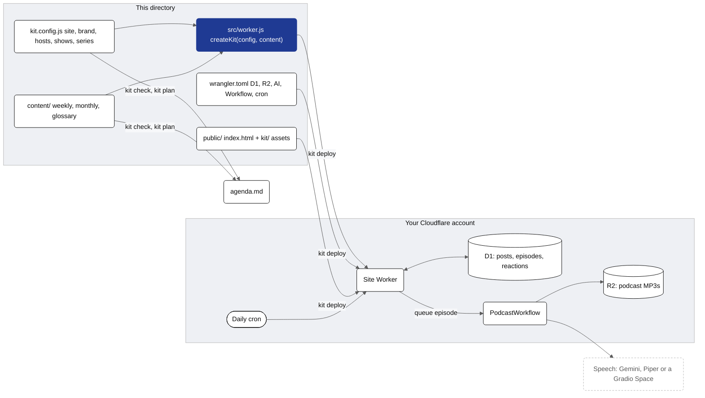

# My kit site

A self-hosted publishing site on Cloudflare, made with kit: a weekly topic
(blog post + two-minute podcast), a monthly report and a glossary term a day (one-minute podcast), published on schedule by
a daily cron, with feeds, a sitemap, `llms.txt`, reactions and sharing.

Everything in `content/` is **sample content** (generic finance examples). Replace it with your own.

## How it fits together


<details><summary>Mermaid source (kit.templates.site.readme.1)</summary>



</details>

| file | what it is |
| --- | --- |
| `kit.config.js` | the site: name, URL, locale, brand colours, hosts and voices, shows, and the series that publish (what, when, slugs) |
| `content/` | the content pack: `weekly.js` (one topic per Monday), `monthly.js` (one theme per month), `glossary.js` (categories and terms) |
| `src/worker.js` | the whole Worker, five lines: `createKit(config, content)` |
| `public/` | the landing page and `public/kit/` (client CSS/JS, written by `kit init` and refreshed by `kit deploy`) |
| `wrangler.toml` | Cloudflare bindings: D1 `DB`, R2 `PODCASTS`, Workers AI `AI`, Workflow `PODCAST_WF`, the daily cron, static assets |

## Setup

1. **Install**: `npm install` (Node 20 or newer).
2. **Configure**: edit `kit.config.js` (at least `site.name`, `site.url`, `brand`, `hosts`, `shows`) and replace the sample
   content in `content/`. The sample covers short windows (`start` / `end` on each series); remove `end` once every slot has content.
3. **Check**: `npx kit check` validates the config and every content item (lengths, speakability, alternating speakers, no
   figures in definitions, related terms exist). It exits 1 on any problem.
4. **Plan**: `npx kit plan` writes `agenda.md`, a dry run of everything the next year publishes, with every episode script
   built and timed. `npx kit render weekly 2026-09-28` prints one episode script.
5. **Run locally**: `cp .dev.vars.example .dev.vars`, `npx kit migrate` (local D1), `npx wrangler dev`, then open
   http://localhost:8787. With `npx wrangler dev --test-scheduled`, `curl "http://localhost:8787/cdn-cgi/handler/scheduled?time=<ms>"` runs the daily cron for that moment.
6. **Set up Cloudflare** (once):
   ```sh
   npx wrangler d1 create my-site                 # put the database_id into wrangler.toml
   npx wrangler r2 bucket create my-site-podcasts
   npx wrangler secret put ADMIN_TOKEN            # admin API (kit publish / kit status)
   npx wrangler secret put IP_SALT                # hashing visitor ids for reactions
   npx wrangler secret put GEMINI_API_KEY         # speech; without it no episode is queued
   ```
7. **Migrate**: `npx kit migrate --remote` (applies the D1 migrations shipped with `@saasreport/cloudflare`).
8. **Deploy**: `npx kit deploy` (check, refresh `public/kit/`, `wrangler deploy`). Add `--dry-run` to see the steps first.

After that the cron publishes on its own. Queue or re-render an episode by hand with
`KIT_ADMIN_TOKEN=… npx kit publish weekly 2026-09-28 [--force]` and follow it with `npx kit status [slug]`.

## Persian (RTL, Jalali)

`npx kit init my-site --locale fa` creates the same site in Persian: right-to-left pages, the Solar Hijri calendar with the
official Iranian holidays and business days, weekly topics on Saturdays and a date picker on the landing page.

## Two languages

`npx kit init my-site --locales en,ar` adds `locales/en-ar` over this starter: `site.locales: ["en", "ar"]`, values as
`{ en, ar }`, Gemini voices per locale (placeholders), content keyed per locale (`content/ar/` holds the Arabic sample) and
`public/ar/index.html`. English is served at `/`, Arabic at `/ar/` (blog, podcasts, glossary, feeds; one sitemap with
hreflang and one `llms.txt`).
